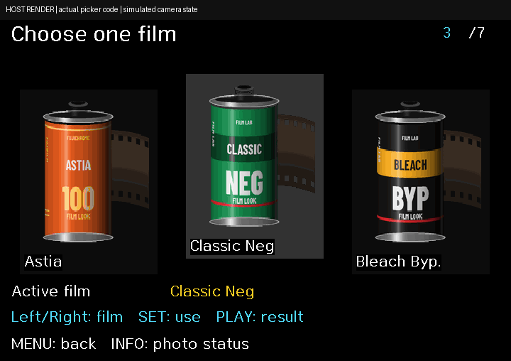

> **หยุดแนะนำใช้ v3r6-lut6 (16 พ.ย. 2026): ผู้ใช้รายงานค้างตั้งแต่เปิดสวิตช์ ไฟแดงกะพริบ และต้องถอดแบตจึงกู้กลับได้ อย่าทดสอบการ์ดชุดนี้ซ้ำ ดู [รายงานและแนวทางกู้กลับ](BOOT_INCIDENT_V3R6-LUT6.md). ยังไม่มีบิลด์แก้ที่ผ่านการทดสอบบนกล้องจริง**

# Thai-Menu v3r6-lut6 — Seven-film trial

เฟิร์มแวร์เสริมสำหรับ **Canon EOS 600D / Canon firmware 1.0.2** รุ่นทดลองสาธารณะ ยังไม่ทดสอบบนกล้องจริงหรือ QEMU

[ดาวน์โหลด UPDATE สำหรับการ์ดที่มี ML แล้ว](https://raw.githubusercontent.com/itsamachom/EOS_ROM_MLV_Modify/v3r6-lut6/downloads/v3r6-lut6/camera/600D-102-Thai-Menu-v3r6-lut6-UPDATE.zip) · [คู่มือและข้อจำกัด](PHOTO_UI_V3R6-LUT6.md) · [SHA256](downloads/v3r6-lut6/SHA256SUMS) · [ซอร์สตรงกับบิลด์](https://raw.githubusercontent.com/itsamachom/EOS_ROM_MLV_Modify/v3r6-lut6/deliveries/photo-ui-v3r6-lut6-full/600D-PHOTO-UI-v3r6-lut6-source.zip)

คัดลอก **autoexec.bin และ ML/ ทั้งชุด** จาก UPDATE ลงรากการ์ด ไม่ต้องเรียก Firmware Update เพื่ออัปเดตชุดนี้

เลือกฟิล์มจากภาพกระป๋องหน้าเดียว ไม่ต้องเลือกหมวดก่อน: **Velvia, Astia, Classic Neg, Bleach Byp., Gold 200, Ektachrome, Fujicolor200** ใช้ซ้าย/ขวาเลือกและ SET ใช้สูตร

สีใน Live View เป็นภาพประมาณจากสัญญาณ Canon ส่วน JPEG เต็ม LUT ประมวลผล RAW หลังถ่ายอัตโนมัติ คง RAW ต้นฉบับ เพิ่มหน้าสถานะระบุชื่อไฟล์ จำนวนสำเร็จ/ล้มเหลว และตัวดูผลล่าสุดใน ML

JPEG ฟิล์มหลักอยู่ `ML/LUTOUT/Lxxx` และเตรียมไฟล์คู่ RAW ใน DCIM พร้อมสำรอง JPEG เดิม **ยังต้องยืนยัน Canon Playback/แอปส่งภาพบนกล้องจริง** ตัวดู ML แสดงผลหลังแปลง หรือเรียกด้วย PLAY แล้วกด PLAY อีกครั้งเพื่อเข้า Canon Playback อ่านรายละเอียดก่อนทดสอบใน [คู่มือ lut6](PHOTO_UI_V3R6-LUT6.md)

บิลด์ ARM และ host tests ใช้ engine/adapter จริงกับ RAW สังเคราะห์ ผ่านการทดสอบคิว การเขียนผิดพลาด การคืน JPEG เดิม การเปิดผลล่าสุด ตาราง Live View และขอบจอ ภาพตัวอย่างเป็น host render ไม่ใช่หลักฐานฮาร์ดแวร์

สูตรข้อมูล Caduceus: [ต้นทาง](https://github.com/cakelesscoder/caduceus-ep7) (Apache-2.0); engine M-Film: GPL-2.0; artwork/fonts คงเครดิตและใบอนุญาตเดิม โมเดลสีสำหรับ Canon เป็นการประมาณ ไม่รับรองความตรงกับ Olympus หรือฟิล์มจริง ดู [THIRD_PARTY_NOTICES.md](THIRD_PARTY_NOTICES.md) และ [AI_ASSISTANCE.md](AI_ASSISTANCE.md)

เอกสารรุ่นก่อน: [lut5 คลังสูตรทั้งหมด](PHOTO_UI_V3R6-LUT5.md) · [tone6 เมนู JPEG เดิม](PHOTO_UI_V3R6-TONE6.md) · [ติดตั้ง](INSTALL_TH.md)
