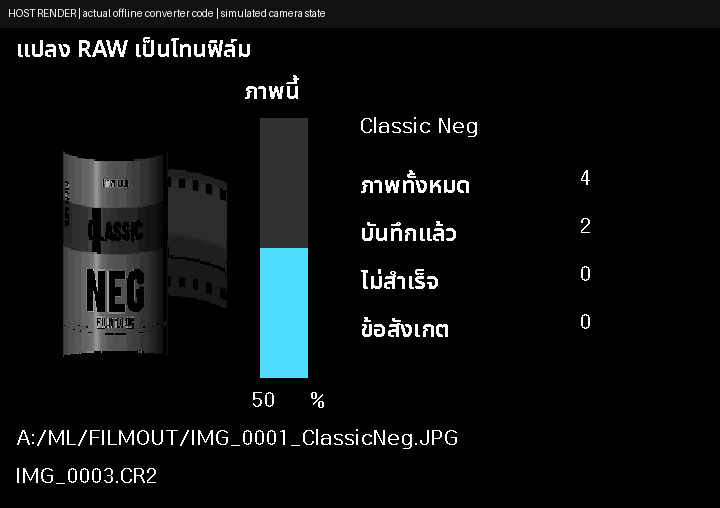

# Thai-Menu v3r6-lut8 — Offline RAW to Film Tone

**Canon EOS 600D / firmware 1.0.2 — รุ่นทดลอง ยังไม่มีผลทดสอบ lut8 บนกล้องจริง** พัฒนาจาก lut7 ที่ผู้ใช้ยืนยันว่าบูตได้

[ดาวน์โหลด UPDATE](https://raw.githubusercontent.com/itsamachom/EOS_ROM_MLV_Modify/v3r6-lut8/downloads/v3r6-lut8/camera/600D-102-Thai-Menu-v3r6-lut8-UPDATE.zip) · [คู่มือ/ข้อจำกัด](../../PHOTO_UI_V3R6-LUT8.md) · [SHA256](SHA256SUMS)

ถ่ายปกติ แล้วเข้า S → FLIM TONE → LUT JPEG เพื่อเปิดเครื่องมือแปลงไฟล์ ไม่โหลดเมื่อบูต ไม่เฝ้าการถ่าย ไม่เปลี่ยนคุณภาพภาพ/ISO/WB และไม่มี Live View LUT

เลือกกลัก **Velvia, Astia, Classic Neg, Gold 200, Ektachrome** → SET → ขึ้น/ลงดู RAW, SET เลือกสูงสุด **4 ภาพ** → Q เริ่มแปลง มีรูปกลัก แถบเปอร์เซ็นต์แนวตั้งและจำนวนทั้งหมด/สำเร็จ/ไม่สำเร็จ

JPEG ชื่อ **IMG_0001_Velvia.JPG** อยู่ ML/FILMOUT พร้อมสำเนาแบบ DCF ใน DCIM/900FILM_ และไฟล์จับคู่ชื่อ ไม่ทับ RAW/Canon JPEG เดิม **ปุ่ม PLAY ส่งให้ Canon ตามปกติ แต่การเห็น JPEG ใหม่ทันทีใน Canon Play ยังไม่ยืนยันบนกล้องจริง** ไม่อ้างว่าแค่มีไฟล์ใน DCIM ก็เปิดได้แน่นอน อ่านข้อจำกัดในคู่มือ

สำรองชุด lut7 ก่อน คัดลอก **autoexec.bin และ ML ทั้งชุด** จาก UPDATE ลงรากการ์ด ไม่เรียก Firmware Update ผ่าน ARM build และ host tests; ไม่มีผล QEMU/hardware ของ lut8

[รายงานปัญหา lut6](../../BOOT_INCIDENT_V3R6-LUT6.md) · [Recovery lut7](../../PHOTO_UI_V3R6-LUT7.md) · [เครดิต/ใบอนุญาต](../../THIRD_PARTY_NOTICES.md) · [AI assistance](../../AI_ASSISTANCE.md)
