# รายการสูตรฟิล์ม v3r6-lut5

มี 64 รายการในแพ็กปัจจุบัน + 64 รายการจาก Standard 1.0/1.1 ที่เก็บแยกไว้ ไม่ใช่ 128 ชื่อฟิล์มที่ต่างกันทั้งหมด ยังมี 3 สูตร lut4 ในกล้องด้วย

ภาพต่อไปนี้เป็นตัวอย่างบนคอมพิวเตอร์จากภาพ CC0 ไม่ใช่ภาพถ่ายจาก Canon 600D และไม่ใช่การยืนยันว่าสีตรง Olympus หรือฟิล์มจริง ภาพแสดงการทำสี ไม่รวม FX เชิงพื้นที่และการลดนอยส์ของกล้อง ดู [เครดิตภาพ](../../assets/film-lab-samples/CREDITS.md) และ [สูตรต้นฉบับทุกค่า](../../firmware/data/lutjpeg/caduceus/CATALOG.json)

## Standard 1.2

### Velvia

สีสด ฟ้าและเขียวเข้ม เงาลึก — Saturated landscape slide film: deep skies, dense greens, crushed shadows. Split: magenta-leaning shade.


<details><summary>ค่าทั้งสูตรจากต้นฉบับ</summary>

```json
{
  "name": "Velvia",
  "notes": "Saturated landscape slide film: deep skies, dense greens, crushed shadows. Split: magenta-leaning shade.",
  "kind": "colour",
  "hue": [
    0,
    0,
    0,
    -1,
    -1,
    -1,
    1,
    2,
    2,
    -2,
    0,
    0
  ],
  "light": [
    0,
    0,
    0,
    0,
    0,
    0,
    -2,
    -2,
    -1,
    0,
    -1,
    -1
  ],
  "sat": [
    4,
    3,
    3,
    4,
    3,
    4,
    4,
    4,
    3,
    3,
    4,
    4
  ],
  "grain": "off",
  "wb": null,
  "effect": null,
  "vignette": 0,
  "art_effect": "off",
  "tone": {
    "highlights": 1,
    "shadows": -4,
    "midtones": 0,
    "blacks": -2,
    "whites": 1
  },
  "advice": {
    "tone": {
      "highlights": 1,
      "shadows": -4,
      "midtones": 0
    },
    "contrast": 2
  },
  "split": {
    "sh_color": 4,
    "sh": 1,
    "hl_color": 0,
    "hl": 0
  },
  "matrix": [
    -4,
    -2,
    -4,
    -4,
    0,
    0
  ]
}
```

</details>

### Astia

นุ่มนวล สีผิวสะอาด ฟ้าชัดขึ้นเล็กน้อย — Soft slide film: gentle contrast, clean skin, slightly richer skies.


<details><summary>ค่าทั้งสูตรจากต้นฉบับ</summary>

```json
{
  "name": "Astia",
  "notes": "Soft slide film: gentle contrast, clean skin, slightly richer skies.",
  "kind": "colour",
  "hue": [
    0,
    1,
    0,
    0,
    0,
    0,
    0,
    1,
    2,
    1,
    -1,
    -1
  ],
  "light": [
    1,
    1,
    1,
    0,
    0,
    0,
    0,
    0,
    0,
    0,
    0,
    0
  ],
  "sat": [
    0,
    -1,
    -1,
    0,
    0,
    1,
    1,
    1,
    0,
    -1,
    -1,
    0
  ],
  "grain": "off",
  "wb": null,
  "effect": null,
  "vignette": 0,
  "art_effect": "off",
  "tone": {
    "highlights": -2,
    "shadows": 1,
    "midtones": 0,
    "blacks": 0,
    "whites": 0
  },
  "advice": {
    "tone": {
      "highlights": -2,
      "shadows": 1,
      "midtones": 0
    },
    "contrast": -1
  }
}
```

</details>

### Cl. Chrome

สีหม่น คอนทราสต์แบบภาพสารคดี — Documentary look: muted greens and yellows, cyan skies, hard shadows.


<details><summary>ค่าทั้งสูตรจากต้นฉบับ</summary>

```json
{
  "name": "Cl. Chrome",
  "notes": "Documentary look: muted greens and yellows, cyan skies, hard shadows.",
  "kind": "colour",
  "hue": [
    -2,
    -1,
    0,
    0,
    3,
    1,
    -2,
    -2,
    -2,
    2,
    0,
    -2
  ],
  "light": [
    -1,
    -1,
    0,
    -1,
    -1,
    -1,
    -1,
    -1,
    -1,
    -1,
    -2,
    -1
  ],
  "sat": [
    -2,
    -1,
    -1,
    -1,
    -1,
    -3,
    -2,
    -2,
    -1,
    -3,
    -3,
    -3
  ],
  "grain": "off",
  "wb": null,
  "effect": null,
  "vignette": 0,
  "art_effect": "off",
  "tone": {
    "highlights": 0,
    "shadows": -3,
    "midtones": 0,
    "blacks": -1,
    "whites": 0
  },
  "advice": {
    "tone": {
      "highlights": 0,
      "shadows": -3,
      "midtones": 0
    },
    "contrast": 1
  },
  "matrix": [
    4,
    2,
    2,
    10,
    2,
    6
  ]
}
```

</details>

### Classic Neg

สีแยกชัด เงาอมเย็นและอุ่นในส่วนสว่าง — Superia-style negative: teal-green cast, punchy mids, light skies; cyan-green shadows, magenta highlights.

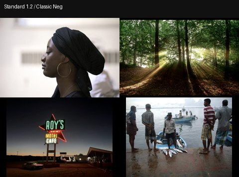

<details><summary>ค่าทั้งสูตรจากต้นฉบับ</summary>

```json
{
  "name": "Classic Neg",
  "notes": "Superia-style negative: teal-green cast, punchy mids, light skies; cyan-green shadows, magenta highlights.",
  "kind": "colour",
  "hue": [
    0,
    -1,
    0,
    0,
    7,
    6,
    -4,
    -3,
    6,
    7,
    5,
    0
  ],
  "light": [
    -2,
    -3,
    -3,
    -2,
    -1,
    1,
    1,
    1,
    -1,
    -3,
    -5,
    -4
  ],
  "sat": [
    -2,
    -1,
    -1,
    1,
    0,
    -4,
    -1,
    -1,
    0,
    -3,
    -3,
    -3
  ],
  "grain": "fine",
  "wb": null,
  "effect": null,
  "vignette": 0,
  "art_effect": "off",
  "tone": {
    "highlights": 4,
    "shadows": -2,
    "midtones": 1,
    "blacks": 0,
    "whites": -1
  },
  "advice": {
    "tone": {
      "highlights": 4,
      "shadows": -2,
      "midtones": 1
    },
    "contrast": 2
  },
  "split": {
    "sh_color": 9,
    "sh": 1,
    "hl_color": 4,
    "hl": 1
  },
  "matrix": [
    7,
    1,
    3,
    1,
    3,
    7
  ]
}
```

</details>

### Provia 400

สีสมดุลแบบสไลด์ คอนทราสต์ปานกลาง — Fujichrome Provia 400X slide: magenta-red cast, lavender skies, rich blues, deep reds, dark greens, fast fall to black, fine grain. Advice: contrast +1.

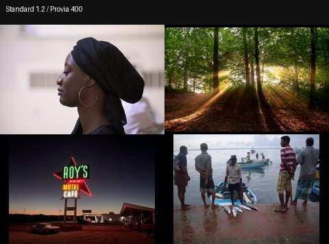

<details><summary>ค่าทั้งสูตรจากต้นฉบับ</summary>

```json
{
  "name": "Provia 400",
  "notes": "Fujichrome Provia 400X slide: magenta-red cast, lavender skies, rich blues, deep reds, dark greens, fast fall to black, fine grain. Advice: contrast +1.",
  "kind": "colour",
  "hue": [
    -3,
    -2,
    -2,
    0,
    0,
    0,
    1,
    0,
    0,
    0,
    0,
    0
  ],
  "light": [
    0,
    0,
    0,
    -1,
    0,
    0,
    -1,
    -1,
    0,
    -1,
    -2,
    -1
  ],
  "sat": [
    0,
    1,
    1,
    1,
    0,
    1,
    1,
    1,
    1,
    0,
    0,
    0
  ],
  "grain": "fine",
  "wb": {
    "a_b": 0,
    "g_m": -3
  },
  "effect": null,
  "vignette": 0,
  "art_effect": "off",
  "tone": {
    "highlights": 0,
    "shadows": -1,
    "midtones": -1,
    "blacks": -1,
    "whites": -3
  },
  "advice": {
    "tone": {
      "highlights": 0,
      "shadows": -1,
      "midtones": -1
    },
    "contrast": 1
  },
  "matrix": [
    0,
    0,
    -4,
    -4,
    0,
    0
  ]
}
```

</details>

### Reala Ace

สีเป็นธรรมชาติและแยกเฉดชัด — Accurate, crisp modern negative: true hues, restrained greens.


<details><summary>ค่าทั้งสูตรจากต้นฉบับ</summary>

```json
{
  "name": "Reala Ace",
  "notes": "Accurate, crisp modern negative: true hues, restrained greens.",
  "kind": "colour",
  "hue": [
    0,
    0,
    0,
    0,
    0,
    0,
    0,
    0,
    0,
    0,
    -1,
    -2
  ],
  "light": [
    0,
    -1,
    -1,
    -1,
    -1,
    -1,
    -3,
    -3,
    -3,
    -1,
    0,
    0
  ],
  "sat": [
    0,
    0,
    0,
    0,
    -1,
    -1,
    0,
    -1,
    -2,
    -3,
    -3,
    -2
  ],
  "grain": "off",
  "wb": null,
  "effect": null,
  "vignette": 0,
  "art_effect": "off",
  "tone": {
    "highlights": 3,
    "shadows": 1,
    "midtones": 0,
    "blacks": 0,
    "whites": -1
  },
  "advice": {
    "tone": {
      "highlights": 3,
      "shadows": 1,
      "midtones": 0
    },
    "contrast": 1
  }
}
```

</details>

### Eterna

โทนภาพยนตร์นุ่ม สีไม่จัด ไฮไลต์อ่อน — Cinema negative: flat, open shadows, quiet teal-leaning colour. Split: cyan shadows, warm highlights.


<details><summary>ค่าทั้งสูตรจากต้นฉบับ</summary>

```json
{
  "name": "Eterna",
  "notes": "Cinema negative: flat, open shadows, quiet teal-leaning colour. Split: cyan shadows, warm highlights.",
  "kind": "colour",
  "hue": [
    0,
    3,
    2,
    0,
    0,
    0,
    -2,
    -4,
    -3,
    0,
    -1,
    -2
  ],
  "light": [
    -1,
    -1,
    -2,
    -3,
    -3,
    -2,
    -2,
    -1,
    -1,
    -1,
    -1,
    -1
  ],
  "sat": [
    -1,
    -1,
    -2,
    -1,
    -1,
    -2,
    -3,
    -4,
    -1,
    -2,
    -2,
    -2
  ],
  "grain": "off",
  "wb": null,
  "effect": null,
  "vignette": 0,
  "art_effect": "off",
  "tone": {
    "highlights": -2,
    "shadows": 4,
    "midtones": 0,
    "blacks": 0,
    "whites": -1
  },
  "advice": {
    "tone": {
      "highlights": -2,
      "shadows": 4,
      "midtones": 0
    },
    "contrast": -2
  },
  "split": {
    "sh_color": 8,
    "sh": 1,
    "hl_color": 1,
    "hl": 1
  },
  "curve": "auto",
  "matrix": [
    6,
    -2,
    2,
    8,
    -4,
    6
  ]
}
```

</details>

### Bleach Byp.

ลดสีและเพิ่มคอนทราสต์ — Silver-retained cinema look: near-monochrome, harsh contrast. Split: steely blue-cyan shadows.

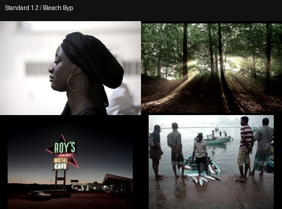

<details><summary>ค่าทั้งสูตรจากต้นฉบับ</summary>

```json
{
  "name": "Bleach Byp.",
  "notes": "Silver-retained cinema look: near-monochrome, harsh contrast. Split: steely blue-cyan shadows.",
  "kind": "colour",
  "hue": [
    0,
    0,
    -2,
    -3,
    0,
    0,
    -3,
    -7,
    -5,
    0,
    0,
    0
  ],
  "light": [
    -2,
    -3,
    -4,
    -5,
    -4,
    -3,
    -1,
    -1,
    -1,
    -2,
    -3,
    -2
  ],
  "sat": [
    -2,
    -2,
    -2,
    -2,
    -2,
    -2,
    -2,
    -2,
    -2,
    -2,
    -2,
    -2
  ],
  "grain": "fine",
  "wb": null,
  "effect": null,
  "vignette": 0,
  "art_effect": "off",
  "tone": {
    "highlights": 4,
    "shadows": -3,
    "midtones": 0,
    "blacks": -2,
    "whites": 1
  },
  "advice": {
    "tone": {
      "highlights": 4,
      "shadows": -3,
      "midtones": 0
    },
    "contrast": 2
  },
  "split": {
    "sh_color": 7,
    "sh": 1,
    "hl_color": 0,
    "hl": 0
  },
  "matrix": [
    26,
    5,
    13,
    5,
    13,
    26
  ]
}
```

</details>

### Kodachrome64

สีอบอุ่น แดงเด่น เงาลึก — Rich deep reds, golden yellows, dense cyan-blue skies, olive greens. Split: warm highlights, slightly cool shadows.


<details><summary>ค่าทั้งสูตรจากต้นฉบับ</summary>

```json
{
  "name": "Kodachrome64",
  "notes": "Rich deep reds, golden yellows, dense cyan-blue skies, olive greens. Split: warm highlights, slightly cool shadows.",
  "kind": "colour",
  "hue": [
    0,
    0,
    0,
    0,
    1,
    0,
    -1,
    -1,
    -1,
    1,
    -1,
    -1
  ],
  "light": [
    -1,
    -2,
    -2,
    -2,
    -1,
    -1,
    -2,
    -1,
    -1,
    -1,
    -2,
    -2
  ],
  "sat": [
    1,
    1,
    1,
    1,
    0,
    -1,
    1,
    1,
    0,
    -1,
    -1,
    0
  ],
  "grain": "fine",
  "wb": null,
  "effect": null,
  "vignette": 0,
  "art_effect": "off",
  "tone": {
    "highlights": -1,
    "shadows": -2,
    "midtones": 0,
    "blacks": -1,
    "whites": 1
  },
  "advice": {
    "tone": {
      "highlights": -1,
      "shadows": -2,
      "midtones": 0
    },
    "contrast": 2
  },
  "split": {
    "sh_color": 7,
    "sh": 1,
    "hl_color": 1,
    "hl": 1
  },
  "matrix": [
    4,
    0,
    -8,
    6,
    -4,
    4
  ]
}
```

</details>

### Portra 400

ผิวนุ่ม สีอุ่น ไฮไลต์นุ่ม — Warm pastel portrait negative: glowing skin, soft contrast. Split: peachy highlights.


<details><summary>ค่าทั้งสูตรจากต้นฉบับ</summary>

```json
{
  "name": "Portra 400",
  "notes": "Warm pastel portrait negative: glowing skin, soft contrast. Split: peachy highlights.",
  "kind": "colour",
  "hue": [
    1,
    1,
    0,
    0,
    0,
    0,
    1,
    0,
    0,
    0,
    -1,
    -1
  ],
  "light": [
    1,
    1,
    1,
    0,
    0,
    0,
    -1,
    0,
    0,
    0,
    0,
    0
  ],
  "sat": [
    0,
    1,
    1,
    0,
    0,
    -1,
    -1,
    -1,
    -1,
    -2,
    -2,
    -1
  ],
  "grain": "fine",
  "wb": null,
  "effect": {
    "type": "bloom",
    "strength": 1
  },
  "vignette": 0,
  "art_effect": "off",
  "tone": {
    "highlights": -2,
    "shadows": 2,
    "midtones": 1,
    "blacks": 0,
    "whites": -2
  },
  "advice": {
    "tone": {
      "highlights": -2,
      "shadows": 2,
      "midtones": 1
    },
    "contrast": -1
  },
  "split": {
    "sh_color": 0,
    "sh": 0,
    "hl_color": 1,
    "hl": 1
  },
  "matrix": [
    8,
    1,
    3,
    1,
    -2,
    2
  ]
}
```

</details>

### Ektar 100

สีสด รายละเอียดฟ้าและเขียวเด่น — Ultra-vivid fine-grain negative: saturated reds and blues. Split: warm highlights, blue deep shadows.


<details><summary>ค่าทั้งสูตรจากต้นฉบับ</summary>

```json
{
  "name": "Ektar 100",
  "notes": "Ultra-vivid fine-grain negative: saturated reds and blues. Split: warm highlights, blue deep shadows.",
  "kind": "colour",
  "hue": [
    0,
    0,
    0,
    1,
    0,
    0,
    0,
    1,
    1,
    0,
    0,
    0
  ],
  "light": [
    0,
    0,
    -1,
    -1,
    0,
    0,
    -2,
    -2,
    -1,
    0,
    0,
    0
  ],
  "sat": [
    1,
    2,
    2,
    2,
    2,
    1,
    3,
    3,
    2,
    0,
    1,
    1
  ],
  "grain": "off",
  "wb": null,
  "effect": null,
  "vignette": 0,
  "art_effect": "off",
  "tone": {
    "highlights": 0,
    "shadows": -1,
    "midtones": 0,
    "blacks": 0,
    "whites": -1
  },
  "advice": {
    "tone": {
      "highlights": 0,
      "shadows": -1,
      "midtones": 0
    },
    "contrast": 2
  },
  "split": {
    "sh_color": 6,
    "sh": 1,
    "hl_color": 1,
    "hl": 1
  },
  "matrix": [
    -3,
    -1,
    -2,
    -1,
    0,
    0
  ]
}
```

</details>

### Gold 200

เหลืองอุ่นแบบฟิล์มถ่ายทั่วไป — Golden consumer negative: sunny yellows, muted cyan skies. Split: yellow-tinted whites.


<details><summary>ค่าทั้งสูตรจากต้นฉบับ</summary>

```json
{
  "name": "Gold 200",
  "notes": "Golden consumer negative: sunny yellows, muted cyan skies. Split: yellow-tinted whites.",
  "kind": "colour",
  "hue": [
    0,
    0,
    0,
    0,
    0,
    0,
    0,
    0,
    0,
    0,
    -2,
    -2
  ],
  "light": [
    2,
    1,
    0,
    0,
    0,
    0,
    0,
    0,
    0,
    0,
    0,
    0
  ],
  "sat": [
    3,
    2,
    0,
    0,
    -1,
    -1,
    -2,
    -2,
    -2,
    -2,
    0,
    2
  ],
  "grain": "fine",
  "wb": {
    "a_b": 1,
    "g_m": 0
  },
  "effect": {
    "type": "bloom",
    "strength": 1
  },
  "vignette": 0,
  "art_effect": "off",
  "tone": {
    "highlights": -1,
    "shadows": 0,
    "midtones": 1,
    "blacks": 0,
    "whites": -1
  },
  "advice": {
    "tone": {
      "highlights": -1,
      "shadows": 0,
      "midtones": 1
    }
  },
  "split": {
    "sh_color": 0,
    "sh": 0,
    "hl_color": 0,
    "hl": 1
  },
  "matrix": [
    0,
    0,
    0,
    4,
    0,
    -6
  ]
}
```

</details>

### Ektachrome

ลักษณะสไลด์ โทนเย็นและสีสะอาด — Clean, cool slide film: neutral skin, bright saturated blues. Split: blue shade.


<details><summary>ค่าทั้งสูตรจากต้นฉบับ</summary>

```json
{
  "name": "Ektachrome",
  "notes": "Clean, cool slide film: neutral skin, bright saturated blues. Split: blue shade.",
  "kind": "colour",
  "hue": [
    0,
    0,
    0,
    0,
    0,
    0,
    1,
    0,
    1,
    0,
    0,
    0
  ],
  "light": [
    0,
    0,
    0,
    0,
    0,
    0,
    -1,
    -1,
    0,
    0,
    0,
    0
  ],
  "sat": [
    0,
    -1,
    0,
    0,
    2,
    3,
    3,
    3,
    3,
    1,
    1,
    0
  ],
  "grain": "off",
  "wb": null,
  "effect": null,
  "vignette": 0,
  "art_effect": "off",
  "tone": {
    "highlights": 0,
    "shadows": -2,
    "midtones": 0,
    "blacks": -1,
    "whites": 1
  },
  "advice": {
    "tone": {
      "highlights": 0,
      "shadows": -2,
      "midtones": 0
    },
    "contrast": 1
  },
  "split": {
    "sh_color": 6,
    "sh": 1,
    "hl_color": 0,
    "hl": 0
  },
  "matrix": [
    0,
    -2,
    0,
    -6,
    0,
    0
  ]
}
```

</details>

### CineStill800

กลางคืน แสงไฟอุ่นและเงาเย็น — Tungsten cinema film: cool cast, red bloom (bloom_tint red: the glow's Cr spreads far more than its luma, docs/HALATION_RED.md section 8) plus red/orange light. Split: cyan shadows, warm highlights.


<details><summary>ค่าทั้งสูตรจากต้นฉบับ</summary>

```json
{
  "name": "CineStill800",
  "notes": "Tungsten cinema film: cool cast, red bloom (bloom_tint red: the glow's Cr spreads far more than its luma, docs/HALATION_RED.md section 8) plus red/orange light. Split: cyan shadows, warm highlights.",
  "kind": "colour",
  "hue": [
    0,
    0,
    -1,
    0,
    0,
    0,
    0,
    -1,
    -1,
    0,
    2,
    0
  ],
  "light": [
    0,
    0,
    2,
    2,
    0,
    0,
    -1,
    0,
    0,
    0,
    0,
    0
  ],
  "sat": [
    -1,
    0,
    2,
    3,
    0,
    0,
    2,
    2,
    2,
    -1,
    -2,
    -2
  ],
  "grain": "film",
  "wb": {
    "a_b": -2,
    "g_m": 0
  },
  "effect": {
    "type": "bloom",
    "strength": 4,
    "tint": "red"
  },
  "vignette": 0,
  "art_effect": "off",
  "tone": {
    "highlights": -1,
    "shadows": 2,
    "midtones": 0,
    "blacks": 0,
    "whites": -1
  },
  "advice": {
    "tone": {
      "highlights": -1,
      "shadows": 2,
      "midtones": 0
    }
  },
  "split": {
    "sh_color": 8,
    "sh": 1,
    "hl_color": 1,
    "hl": 1
  },
  "curve": "auto",
  "matrix": [
    0,
    -4,
    0,
    6,
    -6,
    0
  ]
}
```

</details>

### Pro 400H

สีพาสเทล ผิวสว่างและเขียวอ่อน — Airy pastel negative: minty greens, light cyan skies. Split: green-cyan shade.

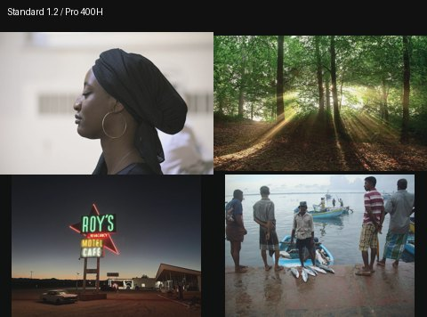

<details><summary>ค่าทั้งสูตรจากต้นฉบับ</summary>

```json
{
  "name": "Pro 400H",
  "notes": "Airy pastel negative: minty greens, light cyan skies. Split: green-cyan shade.",
  "kind": "colour",
  "hue": [
    0,
    0,
    0,
    0,
    0,
    0,
    0,
    0,
    0,
    1,
    2,
    2
  ],
  "light": [
    0,
    0,
    0,
    0,
    0,
    0,
    1,
    1,
    1,
    1,
    1,
    0
  ],
  "sat": [
    -2,
    -2,
    -2,
    -2,
    -2,
    -2,
    0,
    1,
    1,
    0,
    -1,
    -2
  ],
  "grain": "fine",
  "wb": null,
  "effect": {
    "type": "bloom",
    "strength": 1
  },
  "vignette": 0,
  "art_effect": "off",
  "tone": {
    "highlights": -2,
    "shadows": 3,
    "midtones": 2,
    "blacks": 1,
    "whites": -2
  },
  "advice": {
    "tone": {
      "highlights": -2,
      "shadows": 3,
      "midtones": 2
    },
    "contrast": -1
  },
  "split": {
    "sh_color": 9,
    "sh": 1,
    "hl_color": 0,
    "hl": 0
  },
  "matrix": [
    -4,
    0,
    0,
    4,
    0,
    6
  ]
}
```

</details>

### Faux IR

สีผิดธรรมชาติแบบอินฟราเรดจำลอง — Infrared-inspired false colour (golden/orange foliage, deep blue skies). Not true Aerochrome: the hue range can't turn green red. Sat advice: strong (+3..+5). Split: blue shadows, orange highlights.

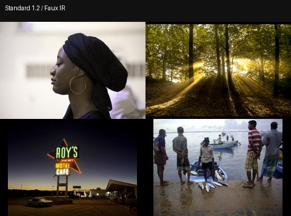

<details><summary>ค่าทั้งสูตรจากต้นฉบับ</summary>

```json
{
  "name": "Faux IR",
  "notes": "Infrared-inspired false colour (golden/orange foliage, deep blue skies). Not true Aerochrome: the hue range can't turn green red. Sat advice: strong (+3..+5). Split: blue shadows, orange highlights.",
  "kind": "colour",
  "hue": [
    -7,
    3,
    5,
    7,
    7,
    7,
    0,
    3,
    7,
    -5,
    -5,
    -5
  ],
  "light": [
    1,
    2,
    2,
    2,
    0,
    0,
    -7,
    -3,
    -2,
    0,
    2,
    1
  ],
  "sat": [
    4,
    -1,
    2,
    3,
    3,
    3,
    2,
    5,
    5,
    3,
    5,
    5
  ],
  "grain": "fine",
  "wb": null,
  "effect": null,
  "vignette": 0,
  "art_effect": "off",
  "tone": {
    "highlights": 1,
    "shadows": -2,
    "midtones": 0,
    "blacks": -1,
    "whites": 0
  },
  "advice": {
    "tone": {
      "highlights": 1,
      "shadows": -2,
      "midtones": 0
    },
    "contrast": 2
  },
  "split": {
    "sh_color": 6,
    "sh": 1,
    "hl_color": 1,
    "hl": 1
  },
  "matrix": [
    32,
    0,
    0,
    0,
    0,
    0
  ]
}
```

</details>

### Kodachrome25

สีสไลด์อุ่นและเข้ม — Kodachrome 25 slide (GarethB, mu-43): dense, rich reds, muted cyan/green, deep shadows. Advice: contrast +2, H-2 M+3 S-5. Split: slightly cool deep shadows.

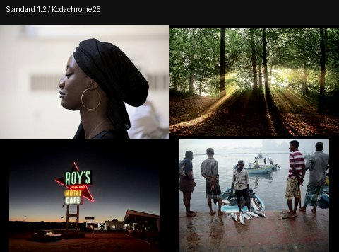

<details><summary>ค่าทั้งสูตรจากต้นฉบับ</summary>

```json
{
  "name": "Kodachrome25",
  "notes": "Kodachrome 25 slide (GarethB, mu-43): dense, rich reds, muted cyan/green, deep shadows. Advice: contrast +2, H-2 M+3 S-5. Split: slightly cool deep shadows.",
  "kind": "colour",
  "hue": [
    0,
    0,
    0,
    0,
    0,
    0,
    -1,
    -1,
    0,
    0,
    -1,
    -1
  ],
  "light": [
    0,
    0,
    -1,
    -1,
    0,
    0,
    -1,
    -1,
    0,
    0,
    -1,
    -1
  ],
  "sat": [
    -2,
    1,
    1,
    -1,
    -1,
    2,
    -3,
    -2,
    -4,
    -3,
    -3,
    -4
  ],
  "grain": "off",
  "wb": {
    "a_b": 0,
    "g_m": 1
  },
  "effect": null,
  "vignette": 0,
  "art_effect": "off",
  "tone": {
    "highlights": -2,
    "shadows": -5,
    "midtones": 3,
    "blacks": -1,
    "whites": 0
  },
  "advice": {
    "tone": {
      "highlights": -2,
      "shadows": -5,
      "midtones": 3
    },
    "contrast": 2
  },
  "split": {
    "sh_color": 6,
    "sh": 1,
    "hl_color": 0,
    "hl": 0
  },
  "matrix": [
    4,
    0,
    -6,
    4,
    -2,
    6
  ]
}
```

</details>

### Portra 160

สีผิวอ่อน คอนทราสต์เบา — Fine-grain portrait negative (I. Mitropoulos, om-recipes): natural skin, quiet greens, soft contrast.


<details><summary>ค่าทั้งสูตรจากต้นฉบับ</summary>

```json
{
  "name": "Portra 160",
  "notes": "Fine-grain portrait negative (I. Mitropoulos, om-recipes): natural skin, quiet greens, soft contrast.",
  "kind": "colour",
  "hue": [
    1,
    1,
    0,
    0,
    0,
    0,
    0,
    0,
    0,
    1,
    -1,
    -1
  ],
  "light": [
    1,
    1,
    1,
    0,
    0,
    0,
    0,
    0,
    0,
    0,
    0,
    0
  ],
  "sat": [
    -2,
    1,
    -1,
    -1,
    -2,
    -3,
    -1,
    -2,
    -2,
    -2,
    -2,
    -1
  ],
  "grain": "off",
  "wb": null,
  "effect": null,
  "vignette": 0,
  "art_effect": "off",
  "tone": {
    "highlights": -1,
    "shadows": 1,
    "midtones": 0,
    "blacks": 0,
    "whites": -1
  },
  "advice": {
    "tone": {
      "highlights": -1,
      "shadows": 1,
      "midtones": 0
    },
    "contrast": -1
  },
  "matrix": [
    4,
    1,
    2,
    1,
    -2,
    4
  ]
}
```

</details>

### Fujicolor200

โทนฟิล์มสีประจำวัน เขียวและฟ้าสมดุล — Fujicolor C200 (J. Bloomer, om-recipes): warm yellows, fresh greens, soft contrast. Split: green-yellow shadows.


<details><summary>ค่าทั้งสูตรจากต้นฉบับ</summary>

```json
{
  "name": "Fujicolor200",
  "notes": "Fujicolor C200 (J. Bloomer, om-recipes): warm yellows, fresh greens, soft contrast. Split: green-yellow shadows.",
  "kind": "colour",
  "hue": [
    0,
    0,
    0,
    0,
    0,
    0,
    0,
    0,
    0,
    0,
    -1,
    -1
  ],
  "light": [
    1,
    0,
    0,
    0,
    0,
    0,
    0,
    0,
    0,
    0,
    0,
    0
  ],
  "sat": [
    2,
    3,
    3,
    1,
    -1,
    -1,
    1,
    1,
    0,
    0,
    1,
    1
  ],
  "grain": "fine",
  "wb": {
    "a_b": 2,
    "g_m": 0
  },
  "effect": null,
  "vignette": 0,
  "art_effect": "off",
  "tone": {
    "highlights": 0,
    "shadows": -3,
    "midtones": 1,
    "blacks": 0,
    "whites": -1
  },
  "advice": {
    "tone": {
      "highlights": 0,
      "shadows": -3,
      "midtones": 1
    },
    "contrast": -1
  },
  "split": {
    "sh_color": 11,
    "sh": 1,
    "hl_color": 0,
    "hl": 0
  },
  "matrix": [
    0,
    0,
    0,
    0,
    0,
    -6
  ]
}
```

</details>

### Cuban Neg

สีอบอุ่น มีบุคลิกย้อนยุค — Inspired by Osan's Classic Cuban Neg: warm Classic Neg, golden cast (WB A+4), deep blues/reds, gritty grain, bloom 3. Sat: +2 warm, -2 greens. Split: golden highlights.

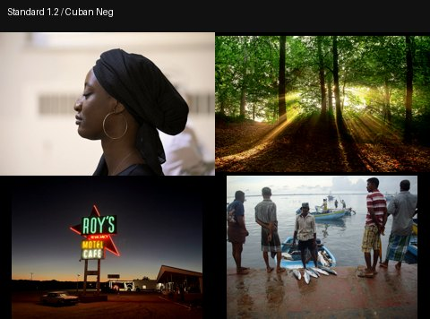

<details><summary>ค่าทั้งสูตรจากต้นฉบับ</summary>

```json
{
  "name": "Cuban Neg",
  "notes": "Inspired by Osan's Classic Cuban Neg: warm Classic Neg, golden cast (WB A+4), deep blues/reds, gritty grain, bloom 3. Sat: +2 warm, -2 greens. Split: golden highlights.",
  "kind": "colour",
  "hue": [
    0,
    -1,
    0,
    0,
    7,
    6,
    -4,
    -3,
    6,
    7,
    5,
    0
  ],
  "light": [
    -1,
    -2,
    -3,
    -3,
    -1,
    0,
    -1,
    -2,
    -2,
    -3,
    -5,
    -4
  ],
  "sat": [
    2,
    2,
    2,
    2,
    0,
    -2,
    1,
    1,
    1,
    -2,
    -1,
    0
  ],
  "grain": "fine",
  "wb": {
    "a_b": 3,
    "g_m": 0
  },
  "effect": {
    "type": "bloom",
    "strength": 3
  },
  "vignette": 0,
  "art_effect": "off",
  "tone": {
    "highlights": 1,
    "shadows": -3,
    "midtones": 1,
    "blacks": 0,
    "whites": -2
  },
  "advice": {
    "tone": {
      "highlights": 1,
      "shadows": -3,
      "midtones": 1
    },
    "contrast": 1
  },
  "split": {
    "sh_color": 0,
    "sh": 0,
    "hl_color": 0,
    "hl": 1
  }
}
```

</details>

### Cibachrome

สีเข้มและอิ่มแบบภาพอัดจากสไลด์ — Cibachrome print (Jay, om-recipes): glossy magenta-reds, deep blues, rich darks. Split: cool deep shadows.


<details><summary>ค่าทั้งสูตรจากต้นฉบับ</summary>

```json
{
  "name": "Cibachrome",
  "notes": "Cibachrome print (Jay, om-recipes): glossy magenta-reds, deep blues, rich darks. Split: cool deep shadows.",
  "kind": "colour",
  "hue": [
    0,
    0,
    0,
    -1,
    0,
    0,
    0,
    0,
    0,
    0,
    0,
    0
  ],
  "light": [
    0,
    0,
    -1,
    -1,
    0,
    0,
    -1,
    -1,
    -1,
    0,
    0,
    0
  ],
  "sat": [
    1,
    3,
    3,
    3,
    3,
    2,
    2,
    3,
    3,
    0,
    2,
    -1
  ],
  "grain": "off",
  "wb": {
    "a_b": 1,
    "g_m": -1
  },
  "effect": null,
  "vignette": 0,
  "art_effect": "off",
  "tone": {
    "highlights": -3,
    "shadows": -2,
    "midtones": 1,
    "blacks": -1,
    "whites": 1
  },
  "advice": {
    "tone": {
      "highlights": -3,
      "shadows": -2,
      "midtones": 1
    },
    "contrast": 1
  },
  "split": {
    "sh_color": 6,
    "sh": 1,
    "hl_color": 0,
    "hl": 0
  },
  "matrix": [
    -2,
    -1,
    -2,
    -1,
    2,
    -2
  ]
}
```

</details>

### UltraMax 400

โทนอุ่น สีชัดสำหรับถ่ายทั่วไป — Kodak consumer negative: warm, punchy reds/yellows, olive greens, visible grain. Split: yellow highlights, blue-violet shadows.


<details><summary>ค่าทั้งสูตรจากต้นฉบับ</summary>

```json
{
  "name": "UltraMax 400",
  "notes": "Kodak consumer negative: warm, punchy reds/yellows, olive greens, visible grain. Split: yellow highlights, blue-violet shadows.",
  "kind": "colour",
  "hue": [
    0,
    0,
    0,
    0,
    0,
    0,
    -1,
    -1,
    0,
    0,
    -1,
    -1
  ],
  "light": [
    1,
    0,
    0,
    -1,
    0,
    0,
    -1,
    -1,
    0,
    0,
    -1,
    0
  ],
  "sat": [
    3,
    2,
    2,
    2,
    0,
    -1,
    0,
    0,
    -1,
    -1,
    1,
    2
  ],
  "grain": "film",
  "wb": null,
  "effect": null,
  "vignette": 0,
  "art_effect": "off",
  "tone": {
    "highlights": 0,
    "shadows": -1,
    "midtones": 0,
    "blacks": 0,
    "whites": -1
  },
  "advice": {
    "tone": {
      "highlights": 0,
      "shadows": -1,
      "midtones": 0
    },
    "contrast": 1
  },
  "split": {
    "sh_color": 5,
    "sh": 1,
    "hl_color": 0,
    "hl": 1
  },
  "matrix": [
    4,
    0,
    0,
    0,
    -4,
    3
  ]
}
```

</details>

### Agfa Vista

สีสดแบบฟิล์มเนกาทีฟ — Agfa Vista 200: vivid magenta-leaning reds, deep blues, cool cheap-film punch. Split: red highlights.


<details><summary>ค่าทั้งสูตรจากต้นฉบับ</summary>

```json
{
  "name": "Agfa Vista",
  "notes": "Agfa Vista 200: vivid magenta-leaning reds, deep blues, cool cheap-film punch. Split: red highlights.",
  "kind": "colour",
  "hue": [
    0,
    0,
    0,
    0,
    0,
    0,
    0,
    0,
    0,
    0,
    1,
    0
  ],
  "light": [
    0,
    0,
    -1,
    -1,
    0,
    0,
    -1,
    -1,
    0,
    0,
    0,
    0
  ],
  "sat": [
    1,
    1,
    3,
    3,
    2,
    0,
    1,
    1,
    0,
    -1,
    0,
    0
  ],
  "grain": "fine",
  "wb": {
    "a_b": 0,
    "g_m": -1
  },
  "effect": null,
  "vignette": 0,
  "art_effect": "off",
  "tone": {
    "highlights": 0,
    "shadows": -1,
    "midtones": 0,
    "blacks": 0,
    "whites": -1
  },
  "advice": {
    "tone": {
      "highlights": 0,
      "shadows": -1,
      "midtones": 0
    },
    "contrast": 1
  },
  "split": {
    "sh_color": 0,
    "sh": 0,
    "hl_color": 3,
    "hl": 1
  },
  "matrix": [
    0,
    0,
    -4,
    -4,
    4,
    0
  ]
}
```

</details>

### CineStill50D

โทนภาพยนตร์กลางวัน — Daylight cinema stock: clean, slightly cool, rich blues, soft highlights, faint red glow.


<details><summary>ค่าทั้งสูตรจากต้นฉบับ</summary>

```json
{
  "name": "CineStill50D",
  "notes": "Daylight cinema stock: clean, slightly cool, rich blues, soft highlights, faint red glow.",
  "kind": "colour",
  "hue": [
    0,
    0,
    0,
    0,
    0,
    0,
    0,
    -1,
    -1,
    1,
    1,
    0
  ],
  "light": [
    1,
    0,
    0,
    0,
    0,
    0,
    -1,
    -1,
    0,
    0,
    0,
    0
  ],
  "sat": [
    0,
    0,
    0,
    0,
    0,
    0,
    1,
    1,
    1,
    -1,
    -1,
    -1
  ],
  "grain": "fine",
  "wb": {
    "a_b": -1,
    "g_m": 0
  },
  "effect": {
    "type": "bloom",
    "strength": 2,
    "tint": "red"
  },
  "vignette": 0,
  "art_effect": "off",
  "tone": {
    "highlights": -2,
    "shadows": 2,
    "midtones": 0,
    "blacks": 0,
    "whites": -2
  },
  "advice": {
    "tone": {
      "highlights": -2,
      "shadows": 2,
      "midtones": 0
    },
    "contrast": -1
  },
  "curve": "auto",
  "matrix": [
    0,
    -2,
    0,
    -4,
    -2,
    0
  ]
}
```

</details>

### Vision3 250D

โทนภาพยนตร์แสงกลางวัน — Kodak daylight cinema negative: flat, wide latitude, gentle teal/orange separation. Split: cyan shadows, warm highlights.


<details><summary>ค่าทั้งสูตรจากต้นฉบับ</summary>

```json
{
  "name": "Vision3 250D",
  "notes": "Kodak daylight cinema negative: flat, wide latitude, gentle teal/orange separation. Split: cyan shadows, warm highlights.",
  "kind": "colour",
  "hue": [
    0,
    1,
    0,
    0,
    0,
    0,
    -1,
    -1,
    -1,
    1,
    1,
    0
  ],
  "light": [
    0,
    0,
    0,
    0,
    0,
    0,
    -1,
    -1,
    0,
    0,
    -1,
    -1
  ],
  "sat": [
    0,
    1,
    1,
    0,
    -1,
    -1,
    0,
    0,
    0,
    -1,
    -1,
    -1
  ],
  "grain": "fine",
  "wb": null,
  "effect": null,
  "vignette": 0,
  "art_effect": "off",
  "tone": {
    "highlights": -3,
    "shadows": 3,
    "midtones": 0,
    "blacks": 0,
    "whites": -1
  },
  "advice": {
    "tone": {
      "highlights": -3,
      "shadows": 3,
      "midtones": 0
    },
    "contrast": -2
  },
  "split": {
    "sh_color": 8,
    "sh": 1,
    "hl_color": 1,
    "hl": 1
  },
  "curve": "auto",
  "matrix": [
    5,
    -3,
    2,
    6,
    -3,
    4
  ]
}
```

</details>

### Vision3 500T

โทนภาพยนตร์แสงทังสเตน — Tungsten cinema negative in daylight: cool teal cast, warm lights, open shadows. Split: cyan shadows, warm highlights.

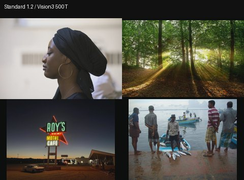

<details><summary>ค่าทั้งสูตรจากต้นฉบับ</summary>

```json
{
  "name": "Vision3 500T",
  "notes": "Tungsten cinema negative in daylight: cool teal cast, warm lights, open shadows. Split: cyan shadows, warm highlights.",
  "kind": "colour",
  "hue": [
    0,
    1,
    0,
    0,
    0,
    0,
    0,
    -1,
    -1,
    1,
    2,
    0
  ],
  "light": [
    0,
    1,
    1,
    0,
    0,
    0,
    -1,
    0,
    0,
    0,
    -1,
    -1
  ],
  "sat": [
    -1,
    0,
    1,
    1,
    -1,
    -1,
    1,
    1,
    1,
    -1,
    -2,
    -2
  ],
  "grain": "film",
  "wb": {
    "a_b": -1,
    "g_m": 0
  },
  "effect": null,
  "vignette": 0,
  "art_effect": "off",
  "tone": {
    "highlights": -2,
    "shadows": 3,
    "midtones": 0,
    "blacks": 0,
    "whites": -1
  },
  "advice": {
    "tone": {
      "highlights": -2,
      "shadows": 3,
      "midtones": 0
    },
    "contrast": -1
  },
  "split": {
    "sh_color": 8,
    "sh": 1,
    "hl_color": 1,
    "hl": 1
  },
  "curve": "auto",
  "matrix": [
    3,
    -3,
    1,
    6,
    -5,
    3
  ]
}
```

</details>

### Polaroid

สีจางและดำยกแบบภาพทันใจ — Integral instant film: punchy, narrow dynamic range (bright highlights, deep shadows), pink highlights, green shadows.

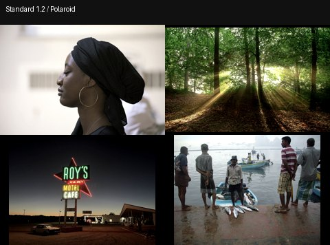

<details><summary>ค่าทั้งสูตรจากต้นฉบับ</summary>

```json
{
  "name": "Polaroid",
  "notes": "Integral instant film: punchy, narrow dynamic range (bright highlights, deep shadows), pink highlights, green shadows.",
  "kind": "colour",
  "hue": [
    1,
    1,
    0,
    0,
    0,
    0,
    -1,
    -1,
    0,
    1,
    2,
    1
  ],
  "light": [
    1,
    1,
    1,
    0,
    0,
    0,
    1,
    1,
    1,
    1,
    0,
    0
  ],
  "sat": [
    0,
    0,
    -1,
    -1,
    -1,
    -1,
    -2,
    -2,
    -1,
    0,
    -1,
    0
  ],
  "grain": "fine",
  "wb": {
    "a_b": 1,
    "g_m": 1
  },
  "effect": {
    "type": "bloom",
    "strength": 2,
    "tint": "warm"
  },
  "vignette": 0,
  "art_effect": "off",
  "tone": {
    "highlights": 2,
    "shadows": -3,
    "midtones": 0,
    "blacks": -1,
    "whites": 1
  },
  "advice": {
    "tone": {
      "highlights": 2,
      "shadows": -3,
      "midtones": 0
    },
    "contrast": 1
  },
  "split": {
    "sh_color": 10,
    "sh": 1,
    "hl_color": 4,
    "hl": 1
  },
  "matrix": [
    8,
    2,
    4,
    2,
    4,
    8
  ]
}
```

</details>

### Cross Proc.

สีเพี้ยนและคอนทราสต์เฉพาะตัว — E-6 slide in C-41: hard contrast, yellow-green highlights, cyan skies, yellowed skin.


<details><summary>ค่าทั้งสูตรจากต้นฉบับ</summary>

```json
{
  "name": "Cross Proc.",
  "notes": "E-6 slide in C-41: hard contrast, yellow-green highlights, cyan skies, yellowed skin.",
  "kind": "colour",
  "hue": [
    0,
    0,
    0,
    -1,
    -1,
    -1,
    -1,
    -1,
    0,
    -1,
    -1,
    -1
  ],
  "light": [
    2,
    1,
    0,
    -1,
    -1,
    0,
    -1,
    -1,
    0,
    0,
    0,
    1
  ],
  "sat": [
    2,
    2,
    2,
    3,
    1,
    0,
    2,
    2,
    2,
    2,
    2,
    2
  ],
  "grain": "film",
  "wb": {
    "a_b": 1,
    "g_m": 1
  },
  "effect": null,
  "vignette": 0,
  "art_effect": "off",
  "tone": {
    "highlights": 2,
    "shadows": -3,
    "midtones": 0,
    "blacks": -1,
    "whites": 1
  },
  "advice": {
    "tone": {
      "highlights": 2,
      "shadows": -3,
      "midtones": 0
    },
    "contrast": 2
  },
  "split": {
    "sh_color": 0,
    "sh": 0,
    "hl_color": 11,
    "hl": 2
  },
  "matrix": [
    0,
    0,
    6,
    10,
    -10,
    -5
  ]
}
```

</details>

### Atrophy

สีเก่าและซีดจาง — Inspired by GxAce's Atrophy: urban-decay grade, near-grey base, muted greens/skies, rust and reds kept, gritty clarity. Sat advice: greens/blues -4..-5. Split: teal-grey shadows, rusty highlights.


<details><summary>ค่าทั้งสูตรจากต้นฉบับ</summary>

```json
{
  "name": "Atrophy",
  "notes": "Inspired by GxAce's Atrophy: urban-decay grade, near-grey base, muted greens/skies, rust and reds kept, gritty clarity. Sat advice: greens/blues -4..-5. Split: teal-grey shadows, rusty highlights.",
  "kind": "colour",
  "hue": [
    -2,
    -1,
    0,
    0,
    2,
    1,
    -2,
    -1,
    0,
    2,
    2,
    -1
  ],
  "light": [
    -1,
    0,
    -1,
    -1,
    -1,
    -1,
    -2,
    -2,
    -1,
    -2,
    -3,
    -2
  ],
  "sat": [
    -1,
    -1,
    1,
    1,
    -3,
    -4,
    -3,
    -3,
    -3,
    -3,
    -3,
    -3
  ],
  "grain": "fine",
  "wb": null,
  "effect": {
    "type": "clarity",
    "strength": 3
  },
  "vignette": 0,
  "art_effect": "off",
  "tone": {
    "highlights": -1,
    "shadows": -2,
    "midtones": 0,
    "blacks": 1,
    "whites": -1
  },
  "advice": {
    "tone": {
      "highlights": -1,
      "shadows": -2,
      "midtones": 0
    },
    "contrast": 1
  },
  "split": {
    "sh_color": 9,
    "sh": 1,
    "hl_color": 2,
    "hl": 1
  },
  "matrix": [
    2,
    0,
    0,
    8,
    0,
    10
  ]
}
```

</details>

### Acros

ขาวดำไล่น้ำหนักนุ่ม — Fine-grain mono: deep blacks, smooth tones, darker reds.


<details><summary>ค่าทั้งสูตรจากต้นฉบับ</summary>

```json
{
  "name": "Acros",
  "notes": "Fine-grain mono: deep blacks, smooth tones, darker reds.",
  "kind": "mono",
  "hue": [
    0,
    0,
    0,
    0,
    0,
    0,
    0,
    0,
    0,
    0,
    0,
    0
  ],
  "light": [
    0,
    0,
    0,
    0,
    0,
    0,
    0,
    0,
    0,
    0,
    0,
    0
  ],
  "sat": [
    0,
    0,
    0,
    0,
    0,
    0,
    0,
    0,
    0,
    0,
    0,
    0
  ],
  "grain": "fine",
  "wb": null,
  "effect": null,
  "vignette": 0,
  "art_effect": "off",
  "tone": {
    "highlights": 0,
    "shadows": 0,
    "midtones": 0,
    "blacks": 0,
    "whites": 0
  },
  "advice": {
    "tone": {
      "highlights": -1,
      "shadows": -2,
      "midtones": 0
    },
    "contrast": 1,
    "mono_filter": {
      "colour": "green",
      "strength": 1
    }
  }
}
```

</details>

### Tri-X 400

ขาวดำคอนทราสต์ชัด — Classic gritty reportage mono: punchy contrast, darker skies.


<details><summary>ค่าทั้งสูตรจากต้นฉบับ</summary>

```json
{
  "name": "Tri-X 400",
  "notes": "Classic gritty reportage mono: punchy contrast, darker skies.",
  "kind": "mono",
  "hue": [
    0,
    0,
    0,
    0,
    0,
    0,
    0,
    0,
    0,
    0,
    0,
    0
  ],
  "light": [
    0,
    0,
    0,
    0,
    0,
    0,
    0,
    0,
    0,
    0,
    0,
    0
  ],
  "sat": [
    0,
    0,
    0,
    0,
    0,
    0,
    0,
    0,
    0,
    0,
    0,
    0
  ],
  "grain": "film",
  "wb": null,
  "effect": null,
  "vignette": 0,
  "art_effect": "off",
  "tone": {
    "highlights": 0,
    "shadows": 0,
    "midtones": 0,
    "blacks": 0,
    "whites": 0
  },
  "advice": {
    "tone": {
      "highlights": -1,
      "shadows": -3,
      "midtones": 0
    },
    "contrast": 2,
    "mono_filter": {
      "colour": "yellow",
      "strength": 2
    }
  }
}
```

</details>

### HP5 Plus

ขาวดำใช้งานทั่วไป มีน้ำหนักกลาง — Soft, grainy mono with wide latitude and open shadows.

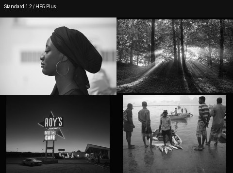

<details><summary>ค่าทั้งสูตรจากต้นฉบับ</summary>

```json
{
  "name": "HP5 Plus",
  "notes": "Soft, grainy mono with wide latitude and open shadows.",
  "kind": "mono",
  "hue": [
    0,
    0,
    0,
    0,
    0,
    0,
    0,
    0,
    0,
    0,
    0,
    0
  ],
  "light": [
    0,
    0,
    0,
    0,
    0,
    0,
    0,
    0,
    0,
    0,
    0,
    0
  ],
  "sat": [
    0,
    0,
    0,
    0,
    0,
    0,
    0,
    0,
    0,
    0,
    0,
    0
  ],
  "grain": "film",
  "wb": null,
  "effect": null,
  "vignette": 0,
  "art_effect": "off",
  "tone": {
    "highlights": 0,
    "shadows": 0,
    "midtones": 0,
    "blacks": 0,
    "whites": 0
  },
  "advice": {
    "tone": {
      "highlights": -2,
      "shadows": 1,
      "midtones": 0
    },
    "mono_filter": {
      "colour": "none",
      "strength": 1
    }
  }
}
```

</details>

## Tokyo Days 1.0

### C200 Airy

โทนเฉพาะหมวด Tokyo Days 1.0 — Fujicolor C200 rated a stop over: bright mids, lighter skies, warm yellows, fresh greens, soft contrast. Split: green-yellow shadows.


<details><summary>ค่าทั้งสูตรจากต้นฉบับ</summary>

```json
{
  "name": "C200 Airy",
  "notes": "Fujicolor C200 rated a stop over: bright mids, lighter skies, warm yellows, fresh greens, soft contrast. Split: green-yellow shadows.",
  "kind": "colour",
  "hue": [
    0,
    0,
    0,
    0,
    0,
    0,
    0,
    0,
    0,
    0,
    -1,
    -1
  ],
  "light": [
    1,
    1,
    0,
    0,
    0,
    0,
    1,
    1,
    1,
    0,
    0,
    0
  ],
  "sat": [
    2,
    2,
    2,
    1,
    -1,
    -1,
    0,
    0,
    0,
    0,
    1,
    1
  ],
  "grain": "fine",
  "wb": {
    "a_b": 1,
    "g_m": 0
  },
  "effect": null,
  "vignette": 0,
  "art_effect": "off",
  "tone": {
    "highlights": -2,
    "shadows": 2,
    "midtones": 2,
    "blacks": 0,
    "whites": -1
  },
  "advice": {
    "tone": {
      "highlights": -2,
      "shadows": 2,
      "midtones": 2
    },
    "contrast": -1
  },
  "split": {
    "sh_color": 11,
    "sh": 1,
    "hl_color": 0,
    "hl": 0
  }
}
```

</details>

### Superia 400

โทนเฉพาะหมวด Tokyo Days 1.0 — Fuji Superia 400 in daylight: teal-leaning greens, cyan-green shade, a magenta lift in the highlights, punchy mids.


<details><summary>ค่าทั้งสูตรจากต้นฉบับ</summary>

```json
{
  "name": "Superia 400",
  "notes": "Fuji Superia 400 in daylight: teal-leaning greens, cyan-green shade, a magenta lift in the highlights, punchy mids.",
  "kind": "colour",
  "hue": [
    0,
    -1,
    0,
    0,
    4,
    3,
    -2,
    -2,
    4,
    5,
    3,
    0
  ],
  "light": [
    -1,
    -2,
    -2,
    -1,
    0,
    1,
    1,
    1,
    0,
    -2,
    -3,
    -2
  ],
  "sat": [
    -1,
    -1,
    -1,
    0,
    -1,
    -3,
    -1,
    -1,
    0,
    -2,
    -2,
    -2
  ],
  "grain": "fine",
  "wb": null,
  "effect": null,
  "vignette": 0,
  "art_effect": "off",
  "tone": {
    "highlights": 2,
    "shadows": -1,
    "midtones": 1,
    "blacks": 0,
    "whites": -1
  },
  "advice": {
    "tone": {
      "highlights": 2,
      "shadows": -1,
      "midtones": 1
    },
    "contrast": 1
  },
  "split": {
    "sh_color": 9,
    "sh": 1,
    "hl_color": 4,
    "hl": 1
  }
}
```

</details>

### 400H Overex

โทนเฉพาะหมวด Tokyo Days 1.0 — Pro 400H overexposed 1-2 stops: the airy pastel look. Milky lifted blacks, soft unclipped highlights, minty greens. Split: green-cyan shade.


<details><summary>ค่าทั้งสูตรจากต้นฉบับ</summary>

```json
{
  "name": "400H Overex",
  "notes": "Pro 400H overexposed 1-2 stops: the airy pastel look. Milky lifted blacks, soft unclipped highlights, minty greens. Split: green-cyan shade.",
  "kind": "colour",
  "hue": [
    0,
    0,
    0,
    0,
    0,
    0,
    0,
    0,
    0,
    2,
    3,
    3
  ],
  "light": [
    1,
    1,
    1,
    0,
    0,
    0,
    1,
    1,
    1,
    1,
    1,
    1
  ],
  "sat": [
    -3,
    -3,
    -3,
    -2,
    -2,
    -2,
    -1,
    0,
    0,
    -1,
    -2,
    -3
  ],
  "grain": "fine",
  "wb": null,
  "effect": {
    "type": "bloom",
    "strength": 1
  },
  "vignette": 0,
  "art_effect": "off",
  "tone": {
    "highlights": -3,
    "shadows": 3,
    "midtones": 2,
    "blacks": 2,
    "whites": -2
  },
  "advice": {
    "tone": {
      "highlights": -3,
      "shadows": 3,
      "midtones": 2
    },
    "contrast": -2
  },
  "split": {
    "sh_color": 9,
    "sh": 1,
    "hl_color": 0,
    "hl": 0
  }
}
```

</details>

### Pro 160NS

โทนเฉพาะหมวด Tokyo Days 1.0 — Fuji Pro 160NS: neutral grey balance, restrained colour, slightly pink skin and a faint purple lean, good greens, soft contrast.


<details><summary>ค่าทั้งสูตรจากต้นฉบับ</summary>

```json
{
  "name": "Pro 160NS",
  "notes": "Fuji Pro 160NS: neutral grey balance, restrained colour, slightly pink skin and a faint purple lean, good greens, soft contrast.",
  "kind": "colour",
  "hue": [
    0,
    -1,
    0,
    0,
    0,
    0,
    1,
    0,
    0,
    0,
    0,
    0
  ],
  "light": [
    1,
    1,
    0,
    0,
    0,
    0,
    0,
    0,
    0,
    0,
    0,
    0
  ],
  "sat": [
    -1,
    -1,
    -1,
    -1,
    -1,
    -1,
    -1,
    -1,
    -1,
    0,
    0,
    0
  ],
  "grain": "off",
  "wb": {
    "a_b": 0,
    "g_m": -1
  },
  "effect": null,
  "vignette": 0,
  "art_effect": "off",
  "tone": {
    "highlights": -1,
    "shadows": 1,
    "midtones": 1,
    "blacks": 0,
    "whites": -1
  },
  "advice": {
    "tone": {
      "highlights": -1,
      "shadows": 1,
      "midtones": 1
    },
    "contrast": -1
  }
}
```

</details>

### Acros

ขาวดำไล่น้ำหนักนุ่ม — Fine-grain mono: deep blacks, smooth tones, darker reds.


<details><summary>ค่าทั้งสูตรจากต้นฉบับ</summary>

```json
{
  "name": "Acros",
  "notes": "Fine-grain mono: deep blacks, smooth tones, darker reds.",
  "kind": "mono",
  "hue": [
    0,
    0,
    0,
    0,
    0,
    0,
    0,
    0,
    0,
    0,
    0,
    0
  ],
  "light": [
    0,
    0,
    0,
    0,
    0,
    0,
    0,
    0,
    0,
    0,
    0,
    0
  ],
  "sat": [
    0,
    0,
    0,
    0,
    0,
    0,
    0,
    0,
    0,
    0,
    0,
    0
  ],
  "grain": "fine",
  "wb": null,
  "effect": null,
  "vignette": 0,
  "art_effect": "off",
  "tone": {
    "highlights": 0,
    "shadows": 0,
    "midtones": 0,
    "blacks": 0,
    "whites": 0
  },
  "advice": {
    "tone": {
      "highlights": -1,
      "shadows": -2,
      "midtones": 0
    },
    "contrast": 1,
    "mono_filter": {
      "colour": "green",
      "strength": 1
    }
  }
}
```

</details>

## Tokyo Nights 1.0

### 800T Neon

โทนเฉพาะหมวด Tokyo Nights 1.0 — CineStill 800T under neon: tungsten-balanced, teal shade, red halation round signs and lamps, richer magentas and blues. Split: cyan shadows, warm highlights.


<details><summary>ค่าทั้งสูตรจากต้นฉบับ</summary>

```json
{
  "name": "800T Neon",
  "notes": "CineStill 800T under neon: tungsten-balanced, teal shade, red halation round signs and lamps, richer magentas and blues. Split: cyan shadows, warm highlights.",
  "kind": "colour",
  "hue": [
    0,
    0,
    -1,
    0,
    0,
    0,
    0,
    -2,
    -2,
    0,
    2,
    0
  ],
  "light": [
    0,
    0,
    2,
    2,
    0,
    0,
    -1,
    0,
    0,
    0,
    0,
    0
  ],
  "sat": [
    -1,
    0,
    2,
    3,
    2,
    1,
    2,
    2,
    2,
    -1,
    -2,
    -2
  ],
  "grain": "film",
  "wb": {
    "a_b": -2,
    "g_m": 0
  },
  "effect": {
    "type": "bloom",
    "strength": 4,
    "tint": "red"
  },
  "vignette": 0,
  "art_effect": "off",
  "tone": {
    "highlights": -1,
    "shadows": 1,
    "midtones": 0,
    "blacks": -1,
    "whites": -1
  },
  "advice": {
    "tone": {
      "highlights": -1,
      "shadows": 1,
      "midtones": 0
    }
  },
  "split": {
    "sh_color": 8,
    "sh": 2,
    "hl_color": 1,
    "hl": 1
  }
}
```

</details>

### Natura 1600

โทนเฉพาะหมวด Tokyo Nights 1.0 — Fuji Natura 1600, the Japan-only night film: natural, slightly muted colour, soft contrast, blacks not quite deep. Split: night skies drift blue.


<details><summary>ค่าทั้งสูตรจากต้นฉบับ</summary>

```json
{
  "name": "Natura 1600",
  "notes": "Fuji Natura 1600, the Japan-only night film: natural, slightly muted colour, soft contrast, blacks not quite deep. Split: night skies drift blue.",
  "kind": "colour",
  "hue": [
    0,
    0,
    0,
    0,
    0,
    0,
    0,
    0,
    0,
    0,
    0,
    0
  ],
  "light": [
    0,
    0,
    0,
    0,
    0,
    0,
    0,
    0,
    0,
    0,
    0,
    0
  ],
  "sat": [
    -1,
    -1,
    -1,
    -1,
    -1,
    -1,
    0,
    0,
    -1,
    -1,
    -1,
    -1
  ],
  "grain": "film",
  "wb": null,
  "effect": null,
  "vignette": 0,
  "art_effect": "off",
  "tone": {
    "highlights": -1,
    "shadows": 1,
    "midtones": 0,
    "blacks": 1,
    "whites": -1
  },
  "advice": {
    "tone": {
      "highlights": -1,
      "shadows": 1,
      "midtones": 0
    },
    "contrast": -1
  },
  "split": {
    "sh_color": 6,
    "sh": 1,
    "hl_color": 0,
    "hl": 0
  }
}
```

</details>

### Portra 800

โทนเฉพาะหมวด Tokyo Nights 1.0 — Portra 800 under street lamps: warm natural skin, colour that holds up in low light, soft contrast, plain glow (antihalation layer: no red halo). Split: warm highlights.


<details><summary>ค่าทั้งสูตรจากต้นฉบับ</summary>

```json
{
  "name": "Portra 800",
  "notes": "Portra 800 under street lamps: warm natural skin, colour that holds up in low light, soft contrast, plain glow (antihalation layer: no red halo). Split: warm highlights.",
  "kind": "colour",
  "hue": [
    1,
    1,
    0,
    0,
    0,
    0,
    0,
    0,
    0,
    0,
    -1,
    -1
  ],
  "light": [
    1,
    1,
    1,
    0,
    0,
    0,
    -1,
    0,
    0,
    0,
    0,
    0
  ],
  "sat": [
    0,
    1,
    1,
    1,
    0,
    0,
    0,
    0,
    0,
    -1,
    -2,
    -1
  ],
  "grain": "film",
  "wb": null,
  "effect": {
    "type": "bloom",
    "strength": 1
  },
  "vignette": 0,
  "art_effect": "off",
  "tone": {
    "highlights": -2,
    "shadows": 2,
    "midtones": 0,
    "blacks": 0,
    "whites": -1
  },
  "advice": {
    "tone": {
      "highlights": -2,
      "shadows": 2,
      "midtones": 0
    },
    "contrast": -1
  },
  "split": {
    "sh_color": 0,
    "sh": 0,
    "hl_color": 1,
    "hl": 1
  }
}
```

</details>

### Superia Nite

โทนเฉพาะหมวด Tokyo Nights 1.0 — Fuji Superia shot at night: underexposed shade goes green, highlights lean magenta, teal-leaning greens. Split: green shadows, magenta highlights.

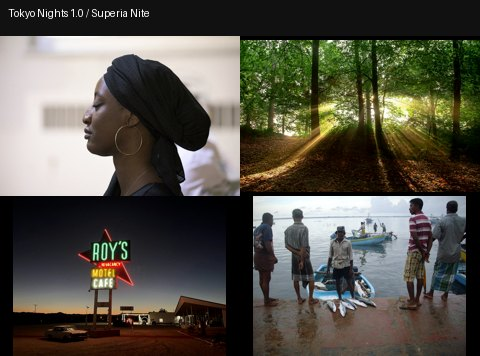

<details><summary>ค่าทั้งสูตรจากต้นฉบับ</summary>

```json
{
  "name": "Superia Nite",
  "notes": "Fuji Superia shot at night: underexposed shade goes green, highlights lean magenta, teal-leaning greens. Split: green shadows, magenta highlights.",
  "kind": "colour",
  "hue": [
    0,
    0,
    0,
    0,
    2,
    2,
    -2,
    -1,
    3,
    3,
    3,
    0
  ],
  "light": [
    -1,
    -1,
    -1,
    -1,
    0,
    0,
    0,
    0,
    -1,
    -2,
    -2,
    -2
  ],
  "sat": [
    0,
    0,
    1,
    1,
    0,
    -1,
    0,
    0,
    0,
    -1,
    -1,
    -1
  ],
  "grain": "film",
  "wb": null,
  "effect": null,
  "vignette": 0,
  "art_effect": "off",
  "tone": {
    "highlights": 1,
    "shadows": -2,
    "midtones": 0,
    "blacks": 0,
    "whites": -1
  },
  "advice": {
    "tone": {
      "highlights": 1,
      "shadows": -2,
      "midtones": 0
    },
    "contrast": 1
  },
  "split": {
    "sh_color": 10,
    "sh": 1,
    "hl_color": 4,
    "hl": 1
  }
}
```

</details>

### 400H Night

โทนเฉพาะหมวด Tokyo Nights 1.0 — Pro 400H after dark: its fourth colour layer keeps fluorescent light clean; cool pastel colour, minty greens, a little more blue for signage. Split: green-cyan shade.

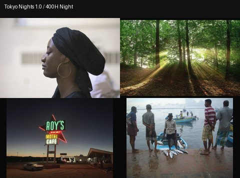

<details><summary>ค่าทั้งสูตรจากต้นฉบับ</summary>

```json
{
  "name": "400H Night",
  "notes": "Pro 400H after dark: its fourth colour layer keeps fluorescent light clean; cool pastel colour, minty greens, a little more blue for signage. Split: green-cyan shade.",
  "kind": "colour",
  "hue": [
    0,
    0,
    0,
    0,
    0,
    0,
    0,
    0,
    0,
    2,
    3,
    3
  ],
  "light": [
    0,
    0,
    0,
    0,
    0,
    0,
    0,
    0,
    0,
    1,
    1,
    0
  ],
  "sat": [
    -2,
    -2,
    -1,
    -1,
    -1,
    -1,
    1,
    1,
    1,
    0,
    -1,
    -2
  ],
  "grain": "fine",
  "wb": null,
  "effect": {
    "type": "bloom",
    "strength": 1
  },
  "vignette": 0,
  "art_effect": "off",
  "tone": {
    "highlights": -1,
    "shadows": 2,
    "midtones": 1,
    "blacks": 0,
    "whites": -1
  },
  "advice": {
    "tone": {
      "highlights": -1,
      "shadows": 2,
      "midtones": 1
    },
    "contrast": -1
  },
  "split": {
    "sh_color": 9,
    "sh": 1,
    "hl_color": 0,
    "hl": 0
  }
}
```

</details>

### Tri-X Push

โทนเฉพาะหมวด Tokyo Nights 1.0 — Tri-X pushed to EI 1600: hard contrast, blocked shadows, burnt-in greys, the grainy Shinjuku-at-night street style. Advice: contrast +2, shadows -4.


<details><summary>ค่าทั้งสูตรจากต้นฉบับ</summary>

```json
{
  "name": "Tri-X Push",
  "notes": "Tri-X pushed to EI 1600: hard contrast, blocked shadows, burnt-in greys, the grainy Shinjuku-at-night street style. Advice: contrast +2, shadows -4.",
  "kind": "mono",
  "hue": [
    0,
    0,
    0,
    0,
    0,
    0,
    0,
    0,
    0,
    0,
    0,
    0
  ],
  "light": [
    0,
    0,
    0,
    0,
    0,
    0,
    0,
    0,
    0,
    0,
    0,
    0
  ],
  "sat": [
    0,
    0,
    0,
    0,
    0,
    0,
    0,
    0,
    0,
    0,
    0,
    0
  ],
  "grain": "film",
  "wb": null,
  "effect": null,
  "vignette": 0,
  "art_effect": "off",
  "tone": {
    "highlights": 0,
    "shadows": 0,
    "midtones": 0,
    "blacks": 0,
    "whites": 0
  },
  "advice": {
    "tone": {
      "highlights": 0,
      "shadows": -4,
      "midtones": 0
    },
    "contrast": 2,
    "mono_filter": {
      "colour": "yellow",
      "strength": 1
    }
  }
}
```

</details>

## Summer 1.0

### Ektar 100

สีสด รายละเอียดฟ้าและเขียวเด่น — Ultra-vivid fine-grain negative: saturated reds and blues. Split: warm highlights, blue deep shadows.

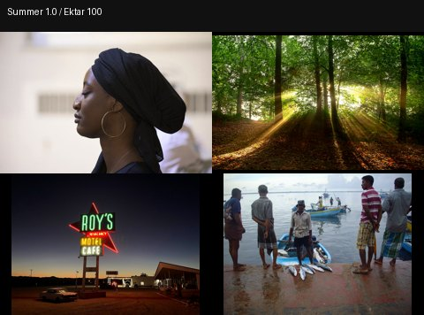

<details><summary>ค่าทั้งสูตรจากต้นฉบับ</summary>

```json
{
  "name": "Ektar 100",
  "notes": "Ultra-vivid fine-grain negative: saturated reds and blues. Split: warm highlights, blue deep shadows.",
  "kind": "colour",
  "hue": [
    0,
    0,
    0,
    1,
    0,
    0,
    0,
    1,
    1,
    0,
    0,
    0
  ],
  "light": [
    0,
    0,
    -1,
    -1,
    0,
    0,
    -2,
    -2,
    -1,
    0,
    0,
    0
  ],
  "sat": [
    1,
    2,
    3,
    3,
    2,
    1,
    4,
    4,
    2,
    0,
    1,
    1
  ],
  "grain": "off",
  "wb": null,
  "effect": null,
  "vignette": 0,
  "art_effect": "off",
  "tone": {
    "highlights": 0,
    "shadows": -1,
    "midtones": 0,
    "blacks": 0,
    "whites": -1
  },
  "advice": {
    "tone": {
      "highlights": 0,
      "shadows": -1,
      "midtones": 0
    },
    "contrast": 2
  },
  "split": {
    "sh_color": 6,
    "sh": 1,
    "hl_color": 1,
    "hl": 1
  }
}
```

</details>

### Velvia Lite

โทนเฉพาะหมวด Summer 1.0 — Velvia toned down for people in summer light: rich skies and greens without the crushed shadows or blown saturation. Split: magenta-leaning shade.


<details><summary>ค่าทั้งสูตรจากต้นฉบับ</summary>

```json
{
  "name": "Velvia Lite",
  "notes": "Velvia toned down for people in summer light: rich skies and greens without the crushed shadows or blown saturation. Split: magenta-leaning shade.",
  "kind": "colour",
  "hue": [
    0,
    0,
    0,
    -1,
    -1,
    -1,
    1,
    2,
    2,
    -2,
    0,
    0
  ],
  "light": [
    0,
    0,
    0,
    0,
    0,
    0,
    -1,
    -1,
    -1,
    0,
    -1,
    -1
  ],
  "sat": [
    2,
    2,
    2,
    3,
    2,
    2,
    3,
    3,
    2,
    2,
    2,
    2
  ],
  "grain": "off",
  "wb": null,
  "effect": null,
  "vignette": 0,
  "art_effect": "off",
  "tone": {
    "highlights": 0,
    "shadows": -2,
    "midtones": 0,
    "blacks": -1,
    "whites": 0
  },
  "advice": {
    "tone": {
      "highlights": 0,
      "shadows": -2,
      "midtones": 0
    },
    "contrast": 1
  },
  "split": {
    "sh_color": 4,
    "sh": 1,
    "hl_color": 0,
    "hl": 0
  }
}
```

</details>

### UltraMax 400

โทนอุ่น สีชัดสำหรับถ่ายทั่วไป — Kodak consumer negative: warm, punchy reds/yellows, olive greens, visible grain. Split: yellow highlights, blue-violet shadows.


<details><summary>ค่าทั้งสูตรจากต้นฉบับ</summary>

```json
{
  "name": "UltraMax 400",
  "notes": "Kodak consumer negative: warm, punchy reds/yellows, olive greens, visible grain. Split: yellow highlights, blue-violet shadows.",
  "kind": "colour",
  "hue": [
    0,
    0,
    0,
    0,
    0,
    0,
    -1,
    -1,
    0,
    0,
    -2,
    -2
  ],
  "light": [
    1,
    0,
    0,
    -1,
    0,
    0,
    -1,
    -1,
    0,
    0,
    -1,
    0
  ],
  "sat": [
    3,
    2,
    2,
    2,
    0,
    -1,
    0,
    0,
    -1,
    -1,
    1,
    2
  ],
  "grain": "film",
  "wb": null,
  "effect": null,
  "vignette": 0,
  "art_effect": "off",
  "tone": {
    "highlights": 0,
    "shadows": -1,
    "midtones": 0,
    "blacks": 0,
    "whites": -1
  },
  "advice": {
    "tone": {
      "highlights": 0,
      "shadows": -1,
      "midtones": 0
    },
    "contrast": 1
  },
  "split": {
    "sh_color": 5,
    "sh": 1,
    "hl_color": 0,
    "hl": 1
  }
}
```

</details>

### X-Pro Sunny

โทนเฉพาะหมวด Summer 1.0 — Gentler cross-processing (E-6 in C-41): high contrast, yellow-green highlights, cyan skies, warm skin, less extreme than Cross Proc. Split: yellow-green highlights.


<details><summary>ค่าทั้งสูตรจากต้นฉบับ</summary>

```json
{
  "name": "X-Pro Sunny",
  "notes": "Gentler cross-processing (E-6 in C-41): high contrast, yellow-green highlights, cyan skies, warm skin, less extreme than Cross Proc. Split: yellow-green highlights.",
  "kind": "colour",
  "hue": [
    -2,
    0,
    0,
    -1,
    -2,
    -1,
    -2,
    -3,
    -2,
    -3,
    -3,
    -3
  ],
  "light": [
    2,
    1,
    0,
    -1,
    -1,
    0,
    0,
    0,
    0,
    0,
    0,
    1
  ],
  "sat": [
    2,
    1,
    1,
    2,
    1,
    0,
    2,
    2,
    2,
    1,
    2,
    3
  ],
  "grain": "film",
  "wb": {
    "a_b": 1,
    "g_m": 0
  },
  "effect": null,
  "vignette": 0,
  "art_effect": "off",
  "tone": {
    "highlights": 1,
    "shadows": -2,
    "midtones": 0,
    "blacks": -1,
    "whites": 1
  },
  "advice": {
    "tone": {
      "highlights": 1,
      "shadows": -2,
      "midtones": 0
    },
    "contrast": 1
  },
  "split": {
    "sh_color": 0,
    "sh": 0,
    "hl_color": 11,
    "hl": 1
  }
}
```

</details>

### Sun Bleach

โทนเฉพาะหมวด Summer 1.0 — Negative overexposed in hard sun: bleached pastels, lifted shadows, soft rolled-off whites, pale skies, warm cast. Split: yellow highlights.


<details><summary>ค่าทั้งสูตรจากต้นฉบับ</summary>

```json
{
  "name": "Sun Bleach",
  "notes": "Negative overexposed in hard sun: bleached pastels, lifted shadows, soft rolled-off whites, pale skies, warm cast. Split: yellow highlights.",
  "kind": "colour",
  "hue": [
    0,
    0,
    0,
    0,
    0,
    0,
    0,
    -1,
    -1,
    0,
    0,
    0
  ],
  "light": [
    1,
    1,
    1,
    0,
    0,
    0,
    1,
    1,
    1,
    1,
    1,
    1
  ],
  "sat": [
    -1,
    -2,
    -2,
    -2,
    -2,
    -2,
    -3,
    -3,
    -2,
    -2,
    -2,
    -1
  ],
  "grain": "fine",
  "wb": {
    "a_b": 1,
    "g_m": 0
  },
  "effect": {
    "type": "bloom",
    "strength": 1
  },
  "vignette": 0,
  "art_effect": "off",
  "tone": {
    "highlights": -3,
    "shadows": 3,
    "midtones": 2,
    "blacks": 2,
    "whites": -2
  },
  "advice": {
    "tone": {
      "highlights": -3,
      "shadows": 3,
      "midtones": 2
    },
    "contrast": -2
  },
  "split": {
    "sh_color": 0,
    "sh": 0,
    "hl_color": 0,
    "hl": 1
  }
}
```

</details>

## Autumn 1.0

### Gold 200

เหลืองอุ่นแบบฟิล์มถ่ายทั่วไป — Golden consumer negative: sunny yellows, muted cyan skies. Split: yellow-tinted whites.

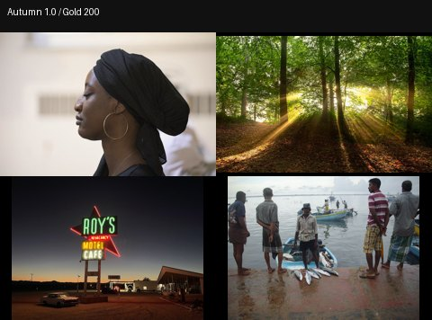

<details><summary>ค่าทั้งสูตรจากต้นฉบับ</summary>

```json
{
  "name": "Gold 200",
  "notes": "Golden consumer negative: sunny yellows, muted cyan skies. Split: yellow-tinted whites.",
  "kind": "colour",
  "hue": [
    0,
    0,
    0,
    0,
    0,
    0,
    0,
    0,
    0,
    0,
    -2,
    -2
  ],
  "light": [
    2,
    1,
    0,
    0,
    0,
    0,
    0,
    0,
    0,
    0,
    0,
    0
  ],
  "sat": [
    4,
    2,
    0,
    0,
    -1,
    -1,
    -2,
    -2,
    -3,
    -2,
    0,
    2
  ],
  "grain": "fine",
  "wb": {
    "a_b": 1,
    "g_m": 0
  },
  "effect": {
    "type": "bloom",
    "strength": 1
  },
  "vignette": 0,
  "art_effect": "off",
  "tone": {
    "highlights": -1,
    "shadows": 0,
    "midtones": 1,
    "blacks": 0,
    "whites": -1
  },
  "advice": {
    "tone": {
      "highlights": -1,
      "shadows": 0,
      "midtones": 1
    }
  },
  "split": {
    "sh_color": 0,
    "sh": 0,
    "hl_color": 0,
    "hl": 1
  }
}
```

</details>

### Portra 400

ผิวนุ่ม สีอุ่น ไฮไลต์นุ่ม — Warm pastel portrait negative: glowing skin, soft contrast. Split: peachy highlights.

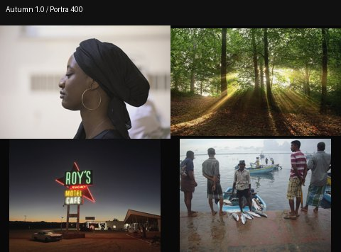

<details><summary>ค่าทั้งสูตรจากต้นฉบับ</summary>

```json
{
  "name": "Portra 400",
  "notes": "Warm pastel portrait negative: glowing skin, soft contrast. Split: peachy highlights.",
  "kind": "colour",
  "hue": [
    1,
    1,
    0,
    0,
    0,
    0,
    1,
    0,
    0,
    0,
    -2,
    -2
  ],
  "light": [
    1,
    1,
    1,
    0,
    0,
    0,
    -1,
    0,
    0,
    0,
    0,
    0
  ],
  "sat": [
    -1,
    0,
    0,
    -1,
    -1,
    -2,
    -2,
    -2,
    -2,
    -3,
    -3,
    -2
  ],
  "grain": "fine",
  "wb": null,
  "effect": {
    "type": "bloom",
    "strength": 1
  },
  "vignette": 0,
  "art_effect": "off",
  "tone": {
    "highlights": -2,
    "shadows": 2,
    "midtones": 1,
    "blacks": 0,
    "whites": -2
  },
  "advice": {
    "tone": {
      "highlights": -2,
      "shadows": 2,
      "midtones": 1
    },
    "contrast": -1
  },
  "split": {
    "sh_color": 0,
    "sh": 0,
    "hl_color": 1,
    "hl": 1
  }
}
```

</details>

### Ektar Autumn

โทนเฉพาะหมวด Autumn 1.0 — Ektar 100 for foliage: saturated reds and oranges, yellow-green leaves pushed golden, deep blue skies. Split: warm highlights, blue deep shadows.


<details><summary>ค่าทั้งสูตรจากต้นฉบับ</summary>

```json
{
  "name": "Ektar Autumn",
  "notes": "Ektar 100 for foliage: saturated reds and oranges, yellow-green leaves pushed golden, deep blue skies. Split: warm highlights, blue deep shadows.",
  "kind": "colour",
  "hue": [
    0,
    0,
    0,
    1,
    0,
    0,
    0,
    1,
    1,
    0,
    -1,
    -2
  ],
  "light": [
    0,
    -1,
    -1,
    -1,
    0,
    0,
    -2,
    -2,
    -1,
    0,
    0,
    0
  ],
  "sat": [
    3,
    3,
    3,
    3,
    1,
    0,
    3,
    3,
    1,
    -1,
    0,
    1
  ],
  "grain": "off",
  "wb": {
    "a_b": 1,
    "g_m": 0
  },
  "effect": null,
  "vignette": 0,
  "art_effect": "off",
  "tone": {
    "highlights": 0,
    "shadows": -1,
    "midtones": 0,
    "blacks": 0,
    "whites": -1
  },
  "advice": {
    "tone": {
      "highlights": 0,
      "shadows": -1,
      "midtones": 0
    },
    "contrast": 2
  },
  "split": {
    "sh_color": 6,
    "sh": 1,
    "hl_color": 1,
    "hl": 1
  }
}
```

</details>

### ColorPlus200

โทนเฉพาะหมวด Autumn 1.0 — Kodak ColorPlus 200: warm, a little less yellow than Gold, moderate saturation, budget-film softness; shade drifts blue-purple. Split: violet shadows.


<details><summary>ค่าทั้งสูตรจากต้นฉบับ</summary>

```json
{
  "name": "ColorPlus200",
  "notes": "Kodak ColorPlus 200: warm, a little less yellow than Gold, moderate saturation, budget-film softness; shade drifts blue-purple. Split: violet shadows.",
  "kind": "colour",
  "hue": [
    0,
    0,
    0,
    0,
    0,
    0,
    0,
    0,
    0,
    0,
    -1,
    -1
  ],
  "light": [
    1,
    0,
    0,
    0,
    0,
    0,
    0,
    0,
    0,
    0,
    0,
    0
  ],
  "sat": [
    2,
    1,
    1,
    1,
    0,
    -1,
    -1,
    -1,
    -2,
    -2,
    -1,
    1
  ],
  "grain": "fine",
  "wb": {
    "a_b": 1,
    "g_m": 0
  },
  "effect": null,
  "vignette": 0,
  "art_effect": "off",
  "tone": {
    "highlights": -1,
    "shadows": -1,
    "midtones": 1,
    "blacks": 0,
    "whites": -1
  },
  "advice": {
    "tone": {
      "highlights": -1,
      "shadows": -1,
      "midtones": 1
    }
  },
  "split": {
    "sh_color": 5,
    "sh": 1,
    "hl_color": 0,
    "hl": 0
  }
}
```

</details>

### Faded Amber

โทนเฉพาะหมวด Autumn 1.0 — Faded warm print (a grade, not a stock): lifted blacks, low saturation, weak blues and greens, amber whites. Split: orange highlights.

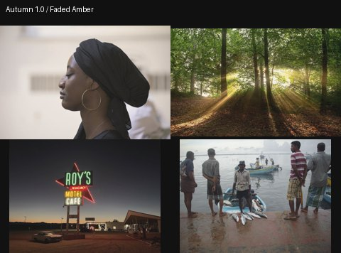

<details><summary>ค่าทั้งสูตรจากต้นฉบับ</summary>

```json
{
  "name": "Faded Amber",
  "notes": "Faded warm print (a grade, not a stock): lifted blacks, low saturation, weak blues and greens, amber whites. Split: orange highlights.",
  "kind": "colour",
  "hue": [
    0,
    0,
    0,
    0,
    0,
    0,
    0,
    0,
    0,
    0,
    -2,
    -2
  ],
  "light": [
    1,
    1,
    0,
    0,
    0,
    0,
    0,
    0,
    0,
    0,
    0,
    0
  ],
  "sat": [
    -1,
    -1,
    -2,
    -2,
    -3,
    -3,
    -4,
    -4,
    -4,
    -3,
    -3,
    -2
  ],
  "grain": "fine",
  "wb": {
    "a_b": 2,
    "g_m": 0
  },
  "effect": null,
  "vignette": 0,
  "art_effect": "off",
  "tone": {
    "highlights": -2,
    "shadows": 2,
    "midtones": 1,
    "blacks": 3,
    "whites": -2
  },
  "advice": {
    "tone": {
      "highlights": -2,
      "shadows": 2,
      "midtones": 1
    },
    "contrast": -2
  },
  "split": {
    "sh_color": 0,
    "sh": 0,
    "hl_color": 1,
    "hl": 1
  }
}
```

</details>

## Winter 1.0

### Portra Cool

โทนเฉพาะหมวด Winter 1.0 — Portra 160 in snow and overcast light: natural skin, quiet colour, one WB step cooler for winter shade (a grading choice). Split: blue-cyan shade.


<details><summary>ค่าทั้งสูตรจากต้นฉบับ</summary>

```json
{
  "name": "Portra Cool",
  "notes": "Portra 160 in snow and overcast light: natural skin, quiet colour, one WB step cooler for winter shade (a grading choice). Split: blue-cyan shade.",
  "kind": "colour",
  "hue": [
    1,
    1,
    0,
    0,
    0,
    0,
    0,
    0,
    0,
    1,
    -1,
    -1
  ],
  "light": [
    1,
    1,
    1,
    0,
    0,
    0,
    0,
    0,
    0,
    0,
    0,
    0
  ],
  "sat": [
    -2,
    1,
    -1,
    -1,
    -2,
    -3,
    -1,
    -2,
    -2,
    -2,
    -3,
    -2
  ],
  "grain": "off",
  "wb": {
    "a_b": -1,
    "g_m": 0
  },
  "effect": null,
  "vignette": 0,
  "art_effect": "off",
  "tone": {
    "highlights": -1,
    "shadows": 1,
    "midtones": 0,
    "blacks": 0,
    "whites": -1
  },
  "advice": {
    "tone": {
      "highlights": -1,
      "shadows": 1,
      "midtones": 0
    },
    "contrast": -1
  },
  "split": {
    "sh_color": 7,
    "sh": 1,
    "hl_color": 0,
    "hl": 0
  }
}
```

</details>

### Pro 400H

สีพาสเทล ผิวสว่างและเขียวอ่อน — Airy pastel negative: minty greens, light cyan skies. Split: green-cyan shade.


<details><summary>ค่าทั้งสูตรจากต้นฉบับ</summary>

```json
{
  "name": "Pro 400H",
  "notes": "Airy pastel negative: minty greens, light cyan skies. Split: green-cyan shade.",
  "kind": "colour",
  "hue": [
    0,
    0,
    0,
    0,
    0,
    0,
    0,
    0,
    0,
    2,
    3,
    3
  ],
  "light": [
    0,
    0,
    0,
    0,
    0,
    0,
    1,
    1,
    1,
    1,
    1,
    0
  ],
  "sat": [
    -2,
    -2,
    -2,
    -2,
    -2,
    -2,
    0,
    1,
    1,
    0,
    -1,
    -2
  ],
  "grain": "fine",
  "wb": null,
  "effect": {
    "type": "bloom",
    "strength": 1
  },
  "vignette": 0,
  "art_effect": "off",
  "tone": {
    "highlights": -2,
    "shadows": 3,
    "midtones": 2,
    "blacks": 1,
    "whites": -2
  },
  "advice": {
    "tone": {
      "highlights": -2,
      "shadows": 3,
      "midtones": 2
    },
    "contrast": -1
  },
  "split": {
    "sh_color": 9,
    "sh": 1,
    "hl_color": 0,
    "hl": 0
  }
}
```

</details>

### E100 Snow

โทนเฉพาะหมวด Winter 1.0 — Ektachrome E100 for snow: clean neutral whites with highlights held, blue shade, crisp but slightly calmer blues than Ektachrome. Split: blue shade.


<details><summary>ค่าทั้งสูตรจากต้นฉบับ</summary>

```json
{
  "name": "E100 Snow",
  "notes": "Ektachrome E100 for snow: clean neutral whites with highlights held, blue shade, crisp but slightly calmer blues than Ektachrome. Split: blue shade.",
  "kind": "colour",
  "hue": [
    0,
    0,
    0,
    0,
    0,
    0,
    1,
    0,
    1,
    0,
    0,
    0
  ],
  "light": [
    0,
    0,
    0,
    0,
    0,
    0,
    -1,
    -1,
    0,
    0,
    0,
    0
  ],
  "sat": [
    0,
    -1,
    -1,
    0,
    1,
    2,
    3,
    3,
    2,
    0,
    0,
    0
  ],
  "grain": "off",
  "wb": null,
  "effect": null,
  "vignette": 0,
  "art_effect": "off",
  "tone": {
    "highlights": -1,
    "shadows": -2,
    "midtones": 0,
    "blacks": -1,
    "whites": 0
  },
  "advice": {
    "tone": {
      "highlights": -1,
      "shadows": -2,
      "midtones": 0
    },
    "contrast": 1
  },
  "split": {
    "sh_color": 6,
    "sh": 1,
    "hl_color": 0,
    "hl": 0
  }
}
```

</details>

### Eterna

โทนภาพยนตร์นุ่ม สีไม่จัด ไฮไลต์อ่อน — Cinema negative: flat, open shadows, quiet teal-leaning colour. Split: cyan shadows, warm highlights.


<details><summary>ค่าทั้งสูตรจากต้นฉบับ</summary>

```json
{
  "name": "Eterna",
  "notes": "Cinema negative: flat, open shadows, quiet teal-leaning colour. Split: cyan shadows, warm highlights.",
  "kind": "colour",
  "hue": [
    0,
    3,
    2,
    0,
    0,
    0,
    -2,
    -6,
    -4,
    0,
    -1,
    -2
  ],
  "light": [
    -1,
    -1,
    -2,
    -3,
    -3,
    -2,
    -2,
    -1,
    -1,
    -1,
    -1,
    -1
  ],
  "sat": [
    -2,
    -2,
    -3,
    -2,
    -2,
    -3,
    -4,
    -5,
    -2,
    -3,
    -3,
    -3
  ],
  "grain": "off",
  "wb": null,
  "effect": null,
  "vignette": 0,
  "art_effect": "off",
  "tone": {
    "highlights": -2,
    "shadows": 4,
    "midtones": 0,
    "blacks": 1,
    "whites": -1
  },
  "advice": {
    "tone": {
      "highlights": -2,
      "shadows": 4,
      "midtones": 0
    },
    "contrast": -2
  },
  "split": {
    "sh_color": 8,
    "sh": 1,
    "hl_color": 1,
    "hl": 1
  }
}
```

</details>

### Acros

ขาวดำไล่น้ำหนักนุ่ม — Fine-grain mono: deep blacks, smooth tones, darker reds.


<details><summary>ค่าทั้งสูตรจากต้นฉบับ</summary>

```json
{
  "name": "Acros",
  "notes": "Fine-grain mono: deep blacks, smooth tones, darker reds.",
  "kind": "mono",
  "hue": [
    0,
    0,
    0,
    0,
    0,
    0,
    0,
    0,
    0,
    0,
    0,
    0
  ],
  "light": [
    0,
    0,
    0,
    0,
    0,
    0,
    0,
    0,
    0,
    0,
    0,
    0
  ],
  "sat": [
    0,
    0,
    0,
    0,
    0,
    0,
    0,
    0,
    0,
    0,
    0,
    0
  ],
  "grain": "fine",
  "wb": null,
  "effect": null,
  "vignette": 0,
  "art_effect": "off",
  "tone": {
    "highlights": 0,
    "shadows": 0,
    "midtones": 0,
    "blacks": 0,
    "whites": 0
  },
  "advice": {
    "tone": {
      "highlights": -1,
      "shadows": -2,
      "midtones": 0
    },
    "contrast": 1,
    "mono_filter": {
      "colour": "green",
      "strength": 1
    }
  }
}
```

</details>

## Film Noir 1.0

### Tri-X 400

ขาวดำคอนทราสต์ชัด — Classic gritty reportage mono: punchy contrast, darker skies.


<details><summary>ค่าทั้งสูตรจากต้นฉบับ</summary>

```json
{
  "name": "Tri-X 400",
  "notes": "Classic gritty reportage mono: punchy contrast, darker skies.",
  "kind": "mono",
  "hue": [
    0,
    0,
    0,
    0,
    0,
    0,
    0,
    0,
    0,
    0,
    0,
    0
  ],
  "light": [
    0,
    0,
    0,
    0,
    0,
    0,
    0,
    0,
    0,
    0,
    0,
    0
  ],
  "sat": [
    0,
    0,
    0,
    0,
    0,
    0,
    0,
    0,
    0,
    0,
    0,
    0
  ],
  "grain": "film",
  "wb": null,
  "effect": null,
  "vignette": 0,
  "art_effect": "off",
  "tone": {
    "highlights": 0,
    "shadows": 0,
    "midtones": 0,
    "blacks": 0,
    "whites": 0
  },
  "advice": {
    "tone": {
      "highlights": -1,
      "shadows": -3,
      "midtones": 0
    },
    "contrast": 2,
    "mono_filter": {
      "colour": "yellow",
      "strength": 2
    }
  }
}
```

</details>

### Tri-X Push

โทนเฉพาะหมวด Film Noir 1.0 — Tri-X pushed to EI 1600: hard contrast, blocked shadows, burnt-in greys, the grainy Shinjuku-at-night street style. Advice: contrast +2, shadows -4.


<details><summary>ค่าทั้งสูตรจากต้นฉบับ</summary>

```json
{
  "name": "Tri-X Push",
  "notes": "Tri-X pushed to EI 1600: hard contrast, blocked shadows, burnt-in greys, the grainy Shinjuku-at-night street style. Advice: contrast +2, shadows -4.",
  "kind": "mono",
  "hue": [
    0,
    0,
    0,
    0,
    0,
    0,
    0,
    0,
    0,
    0,
    0,
    0
  ],
  "light": [
    0,
    0,
    0,
    0,
    0,
    0,
    0,
    0,
    0,
    0,
    0,
    0
  ],
  "sat": [
    0,
    0,
    0,
    0,
    0,
    0,
    0,
    0,
    0,
    0,
    0,
    0
  ],
  "grain": "film",
  "wb": null,
  "effect": null,
  "vignette": 0,
  "art_effect": "off",
  "tone": {
    "highlights": 0,
    "shadows": 0,
    "midtones": 0,
    "blacks": 0,
    "whites": 0
  },
  "advice": {
    "tone": {
      "highlights": 0,
      "shadows": -4,
      "midtones": 0
    },
    "contrast": 2,
    "mono_filter": {
      "colour": "yellow",
      "strength": 1
    }
  }
}
```

</details>

### HP5 Plus

ขาวดำใช้งานทั่วไป มีน้ำหนักกลาง — Soft, grainy mono with wide latitude and open shadows.


<details><summary>ค่าทั้งสูตรจากต้นฉบับ</summary>

```json
{
  "name": "HP5 Plus",
  "notes": "Soft, grainy mono with wide latitude and open shadows.",
  "kind": "mono",
  "hue": [
    0,
    0,
    0,
    0,
    0,
    0,
    0,
    0,
    0,
    0,
    0,
    0
  ],
  "light": [
    0,
    0,
    0,
    0,
    0,
    0,
    0,
    0,
    0,
    0,
    0,
    0
  ],
  "sat": [
    0,
    0,
    0,
    0,
    0,
    0,
    0,
    0,
    0,
    0,
    0,
    0
  ],
  "grain": "film",
  "wb": null,
  "effect": null,
  "vignette": 0,
  "art_effect": "off",
  "tone": {
    "highlights": 0,
    "shadows": 0,
    "midtones": 0,
    "blacks": 0,
    "whites": 0
  },
  "advice": {
    "tone": {
      "highlights": -2,
      "shadows": 1,
      "midtones": 0
    },
    "mono_filter": {
      "colour": "none",
      "strength": 1
    }
  }
}
```

</details>

### Acros

ขาวดำไล่น้ำหนักนุ่ม — Fine-grain mono: deep blacks, smooth tones, darker reds.


<details><summary>ค่าทั้งสูตรจากต้นฉบับ</summary>

```json
{
  "name": "Acros",
  "notes": "Fine-grain mono: deep blacks, smooth tones, darker reds.",
  "kind": "mono",
  "hue": [
    0,
    0,
    0,
    0,
    0,
    0,
    0,
    0,
    0,
    0,
    0,
    0
  ],
  "light": [
    0,
    0,
    0,
    0,
    0,
    0,
    0,
    0,
    0,
    0,
    0,
    0
  ],
  "sat": [
    0,
    0,
    0,
    0,
    0,
    0,
    0,
    0,
    0,
    0,
    0,
    0
  ],
  "grain": "fine",
  "wb": null,
  "effect": null,
  "vignette": 0,
  "art_effect": "off",
  "tone": {
    "highlights": 0,
    "shadows": 0,
    "midtones": 0,
    "blacks": 0,
    "whites": 0
  },
  "advice": {
    "tone": {
      "highlights": -1,
      "shadows": -2,
      "midtones": 0
    },
    "contrast": 1,
    "mono_filter": {
      "colour": "green",
      "strength": 1
    }
  }
}
```

</details>

### Pan F 50

โทนเฉพาะหมวด Film Noir 1.0 — Ilford Pan F Plus 50: very fine grain, high contrast, deep rich blacks, crisp edges. Bright light. Advice: contrast +2, shadows -3.


<details><summary>ค่าทั้งสูตรจากต้นฉบับ</summary>

```json
{
  "name": "Pan F 50",
  "notes": "Ilford Pan F Plus 50: very fine grain, high contrast, deep rich blacks, crisp edges. Bright light. Advice: contrast +2, shadows -3.",
  "kind": "mono",
  "hue": [
    0,
    0,
    0,
    0,
    0,
    0,
    0,
    0,
    0,
    0,
    0,
    0
  ],
  "light": [
    0,
    0,
    0,
    0,
    0,
    0,
    0,
    0,
    0,
    0,
    0,
    0
  ],
  "sat": [
    0,
    0,
    0,
    0,
    0,
    0,
    0,
    0,
    0,
    0,
    0,
    0
  ],
  "grain": "off",
  "wb": null,
  "effect": null,
  "vignette": 0,
  "art_effect": "off",
  "tone": {
    "highlights": 0,
    "shadows": 0,
    "midtones": 0,
    "blacks": 0,
    "whites": 0
  },
  "advice": {
    "tone": {
      "highlights": 0,
      "shadows": -3,
      "midtones": 0
    },
    "contrast": 2,
    "mono_filter": {
      "colour": "none",
      "strength": 1
    }
  }
}
```

</details>

### Bleach Byp.

ลดสีและเพิ่มคอนทราสต์ — Silver-retained cinema look: near-monochrome, harsh contrast. Split: steely blue-cyan shadows.

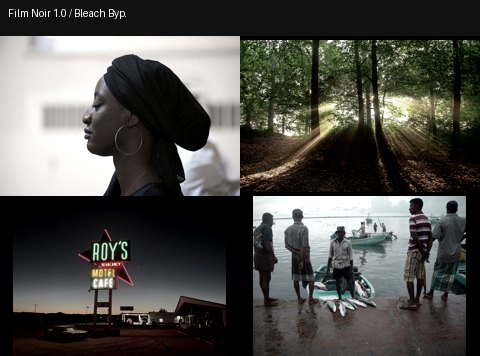

<details><summary>ค่าทั้งสูตรจากต้นฉบับ</summary>

```json
{
  "name": "Bleach Byp.",
  "notes": "Silver-retained cinema look: near-monochrome, harsh contrast. Split: steely blue-cyan shadows.",
  "kind": "colour",
  "hue": [
    0,
    0,
    -2,
    -3,
    0,
    0,
    -3,
    -7,
    -5,
    0,
    0,
    0
  ],
  "light": [
    -2,
    -3,
    -4,
    -5,
    -4,
    -3,
    -1,
    -1,
    -1,
    -2,
    -3,
    -2
  ],
  "sat": [
    -5,
    -5,
    -5,
    -5,
    -5,
    -5,
    -5,
    -5,
    -5,
    -5,
    -5,
    -5
  ],
  "grain": "fine",
  "wb": null,
  "effect": null,
  "vignette": 0,
  "art_effect": "off",
  "tone": {
    "highlights": 4,
    "shadows": -3,
    "midtones": 0,
    "blacks": -2,
    "whites": 1
  },
  "advice": {
    "tone": {
      "highlights": 4,
      "shadows": -3,
      "midtones": 0
    },
    "contrast": 2
  },
  "split": {
    "sh_color": 7,
    "sh": 1,
    "hl_color": 0,
    "hl": 0
  }
}
```

</details>

## Standard 1.1

### Velvia

สีสด ฟ้าและเขียวเข้ม เงาลึก — Saturated landscape slide film: deep skies, dense greens, crushed shadows. Split: magenta-leaning shade.


<details><summary>ค่าทั้งสูตรจากต้นฉบับ</summary>

```json
{
  "name": "Velvia",
  "notes": "Saturated landscape slide film: deep skies, dense greens, crushed shadows. Split: magenta-leaning shade.",
  "kind": "colour",
  "hue": [
    0,
    0,
    0,
    -1,
    -1,
    -1,
    1,
    2,
    2,
    -2,
    0,
    0
  ],
  "light": [
    0,
    0,
    0,
    0,
    0,
    0,
    -2,
    -2,
    -1,
    0,
    -1,
    -1
  ],
  "sat": [
    4,
    4,
    4,
    5,
    3,
    4,
    5,
    5,
    3,
    3,
    4,
    4
  ],
  "grain": "off",
  "wb": null,
  "effect": null,
  "vignette": 0,
  "art_effect": "off",
  "tone": {
    "highlights": 1,
    "shadows": -4,
    "midtones": 0,
    "blacks": -2,
    "whites": 1
  },
  "advice": {
    "tone": {
      "highlights": 1,
      "shadows": -4,
      "midtones": 0
    },
    "contrast": 2
  },
  "split": {
    "sh_color": 4,
    "sh": 1,
    "hl_color": 0,
    "hl": 0
  }
}
```

</details>

### Astia

นุ่มนวล สีผิวสะอาด ฟ้าชัดขึ้นเล็กน้อย — Soft slide film: gentle contrast, clean skin, slightly richer skies.


<details><summary>ค่าทั้งสูตรจากต้นฉบับ</summary>

```json
{
  "name": "Astia",
  "notes": "Soft slide film: gentle contrast, clean skin, slightly richer skies.",
  "kind": "colour",
  "hue": [
    0,
    1,
    0,
    0,
    0,
    0,
    0,
    1,
    2,
    1,
    -1,
    -1
  ],
  "light": [
    1,
    1,
    1,
    0,
    0,
    0,
    0,
    0,
    0,
    0,
    0,
    0
  ],
  "sat": [
    0,
    -1,
    -1,
    0,
    0,
    1,
    1,
    1,
    0,
    -1,
    -1,
    0
  ],
  "grain": "off",
  "wb": null,
  "effect": null,
  "vignette": 0,
  "art_effect": "off",
  "tone": {
    "highlights": -2,
    "shadows": 1,
    "midtones": 0,
    "blacks": 0,
    "whites": 0
  },
  "advice": {
    "tone": {
      "highlights": -2,
      "shadows": 1,
      "midtones": 0
    },
    "contrast": -1
  }
}
```

</details>

### Cl. Chrome

สีหม่น คอนทราสต์แบบภาพสารคดี — Documentary look: muted greens and yellows, cyan skies, hard shadows.

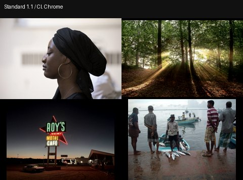

<details><summary>ค่าทั้งสูตรจากต้นฉบับ</summary>

```json
{
  "name": "Cl. Chrome",
  "notes": "Documentary look: muted greens and yellows, cyan skies, hard shadows.",
  "kind": "colour",
  "hue": [
    -2,
    -1,
    0,
    0,
    3,
    1,
    -2,
    -4,
    -2,
    2,
    0,
    -2
  ],
  "light": [
    -1,
    -1,
    0,
    -1,
    -1,
    -1,
    -1,
    -1,
    -1,
    -1,
    -2,
    -1
  ],
  "sat": [
    -2,
    -1,
    -1,
    -1,
    -1,
    -3,
    -3,
    -3,
    -1,
    -3,
    -4,
    -4
  ],
  "grain": "off",
  "wb": null,
  "effect": null,
  "vignette": 0,
  "art_effect": "off",
  "tone": {
    "highlights": 0,
    "shadows": -3,
    "midtones": 0,
    "blacks": -1,
    "whites": 0
  },
  "advice": {
    "tone": {
      "highlights": 0,
      "shadows": -3,
      "midtones": 0
    },
    "contrast": 1
  }
}
```

</details>

### Classic Neg

สีแยกชัด เงาอมเย็นและอุ่นในส่วนสว่าง — Superia-style negative: teal-green cast, punchy mids, light skies; cyan-green shadows, magenta highlights.


<details><summary>ค่าทั้งสูตรจากต้นฉบับ</summary>

```json
{
  "name": "Classic Neg",
  "notes": "Superia-style negative: teal-green cast, punchy mids, light skies; cyan-green shadows, magenta highlights.",
  "kind": "colour",
  "hue": [
    0,
    -1,
    0,
    0,
    7,
    6,
    -4,
    -3,
    6,
    7,
    5,
    0
  ],
  "light": [
    -2,
    -3,
    -3,
    -2,
    -1,
    1,
    1,
    1,
    -1,
    -3,
    -5,
    -4
  ],
  "sat": [
    -3,
    -2,
    -2,
    0,
    -1,
    -5,
    -2,
    -2,
    -1,
    -4,
    -4,
    -4
  ],
  "grain": "fine",
  "wb": null,
  "effect": null,
  "vignette": 0,
  "art_effect": "off",
  "tone": {
    "highlights": 4,
    "shadows": -2,
    "midtones": 1,
    "blacks": 0,
    "whites": -1
  },
  "advice": {
    "tone": {
      "highlights": 4,
      "shadows": -2,
      "midtones": 1
    },
    "contrast": 2
  },
  "split": {
    "sh_color": 9,
    "sh": 1,
    "hl_color": 4,
    "hl": 1
  }
}
```

</details>

### Provia 400

สีสมดุลแบบสไลด์ คอนทราสต์ปานกลาง — Fujichrome Provia 400X slide: magenta-red cast, lavender skies, rich blues, deep reds, dark greens, fast fall to black, fine grain. Advice: contrast +1.


<details><summary>ค่าทั้งสูตรจากต้นฉบับ</summary>

```json
{
  "name": "Provia 400",
  "notes": "Fujichrome Provia 400X slide: magenta-red cast, lavender skies, rich blues, deep reds, dark greens, fast fall to black, fine grain. Advice: contrast +1.",
  "kind": "colour",
  "hue": [
    -3,
    -2,
    -2,
    0,
    0,
    0,
    1,
    0,
    0,
    0,
    0,
    0
  ],
  "light": [
    0,
    0,
    0,
    -1,
    0,
    0,
    -1,
    -1,
    0,
    -1,
    -2,
    -1
  ],
  "sat": [
    0,
    1,
    1,
    1,
    0,
    1,
    2,
    2,
    1,
    0,
    0,
    0
  ],
  "grain": "fine",
  "wb": {
    "a_b": 0,
    "g_m": -3
  },
  "effect": null,
  "vignette": 0,
  "art_effect": "off",
  "tone": {
    "highlights": 0,
    "shadows": -1,
    "midtones": -1,
    "blacks": -1,
    "whites": -3
  },
  "advice": {
    "tone": {
      "highlights": 0,
      "shadows": -1,
      "midtones": -1
    },
    "contrast": 1
  }
}
```

</details>

### Reala Ace

สีเป็นธรรมชาติและแยกเฉดชัด — Accurate, crisp modern negative: true hues, restrained greens.


<details><summary>ค่าทั้งสูตรจากต้นฉบับ</summary>

```json
{
  "name": "Reala Ace",
  "notes": "Accurate, crisp modern negative: true hues, restrained greens.",
  "kind": "colour",
  "hue": [
    0,
    0,
    0,
    0,
    0,
    0,
    0,
    0,
    0,
    0,
    -1,
    -2
  ],
  "light": [
    0,
    -1,
    -1,
    -1,
    -1,
    -1,
    -3,
    -3,
    -3,
    -1,
    0,
    0
  ],
  "sat": [
    0,
    0,
    0,
    0,
    -1,
    -1,
    0,
    -1,
    -2,
    -3,
    -3,
    -2
  ],
  "grain": "off",
  "wb": null,
  "effect": null,
  "vignette": 0,
  "art_effect": "off",
  "tone": {
    "highlights": 3,
    "shadows": 1,
    "midtones": 0,
    "blacks": 0,
    "whites": -1
  },
  "advice": {
    "tone": {
      "highlights": 3,
      "shadows": 1,
      "midtones": 0
    },
    "contrast": 1
  }
}
```

</details>

### Eterna

โทนภาพยนตร์นุ่ม สีไม่จัด ไฮไลต์อ่อน — Cinema negative: flat, open shadows, quiet teal-leaning colour. Split: cyan shadows, warm highlights.


<details><summary>ค่าทั้งสูตรจากต้นฉบับ</summary>

```json
{
  "name": "Eterna",
  "notes": "Cinema negative: flat, open shadows, quiet teal-leaning colour. Split: cyan shadows, warm highlights.",
  "kind": "colour",
  "hue": [
    0,
    3,
    2,
    0,
    0,
    0,
    -2,
    -6,
    -4,
    0,
    -1,
    -2
  ],
  "light": [
    -1,
    -1,
    -2,
    -3,
    -3,
    -2,
    -2,
    -1,
    -1,
    -1,
    -1,
    -1
  ],
  "sat": [
    -2,
    -2,
    -3,
    -2,
    -2,
    -3,
    -4,
    -5,
    -2,
    -3,
    -3,
    -3
  ],
  "grain": "off",
  "wb": null,
  "effect": null,
  "vignette": 0,
  "art_effect": "off",
  "tone": {
    "highlights": -2,
    "shadows": 4,
    "midtones": 0,
    "blacks": 1,
    "whites": -1
  },
  "advice": {
    "tone": {
      "highlights": -2,
      "shadows": 4,
      "midtones": 0
    },
    "contrast": -2
  },
  "split": {
    "sh_color": 8,
    "sh": 1,
    "hl_color": 1,
    "hl": 1
  }
}
```

</details>

### Bleach Byp.

ลดสีและเพิ่มคอนทราสต์ — Silver-retained cinema look: near-monochrome, harsh contrast. Split: steely blue-cyan shadows.


<details><summary>ค่าทั้งสูตรจากต้นฉบับ</summary>

```json
{
  "name": "Bleach Byp.",
  "notes": "Silver-retained cinema look: near-monochrome, harsh contrast. Split: steely blue-cyan shadows.",
  "kind": "colour",
  "hue": [
    0,
    0,
    -2,
    -3,
    0,
    0,
    -3,
    -7,
    -5,
    0,
    0,
    0
  ],
  "light": [
    -2,
    -3,
    -4,
    -5,
    -4,
    -3,
    -1,
    -1,
    -1,
    -2,
    -3,
    -2
  ],
  "sat": [
    -5,
    -5,
    -5,
    -5,
    -5,
    -5,
    -5,
    -5,
    -5,
    -5,
    -5,
    -5
  ],
  "grain": "fine",
  "wb": null,
  "effect": null,
  "vignette": 0,
  "art_effect": "off",
  "tone": {
    "highlights": 4,
    "shadows": -3,
    "midtones": 0,
    "blacks": -2,
    "whites": 1
  },
  "advice": {
    "tone": {
      "highlights": 4,
      "shadows": -3,
      "midtones": 0
    },
    "contrast": 2
  },
  "split": {
    "sh_color": 7,
    "sh": 1,
    "hl_color": 0,
    "hl": 0
  }
}
```

</details>

### Kodachrome64

สีอบอุ่น แดงเด่น เงาลึก — Rich deep reds, golden yellows, dense cyan-blue skies, olive greens. Split: warm highlights, slightly cool shadows.


<details><summary>ค่าทั้งสูตรจากต้นฉบับ</summary>

```json
{
  "name": "Kodachrome64",
  "notes": "Rich deep reds, golden yellows, dense cyan-blue skies, olive greens. Split: warm highlights, slightly cool shadows.",
  "kind": "colour",
  "hue": [
    0,
    0,
    0,
    0,
    1,
    0,
    -1,
    -2,
    -1,
    1,
    -1,
    -1
  ],
  "light": [
    -1,
    -2,
    -2,
    -2,
    -1,
    -1,
    -2,
    -1,
    -1,
    -1,
    -2,
    -2
  ],
  "sat": [
    1,
    1,
    2,
    2,
    0,
    -1,
    1,
    1,
    0,
    -1,
    -1,
    0
  ],
  "grain": "fine",
  "wb": null,
  "effect": null,
  "vignette": 0,
  "art_effect": "off",
  "tone": {
    "highlights": -1,
    "shadows": -2,
    "midtones": 0,
    "blacks": -1,
    "whites": 1
  },
  "advice": {
    "tone": {
      "highlights": -1,
      "shadows": -2,
      "midtones": 0
    },
    "contrast": 2
  },
  "split": {
    "sh_color": 7,
    "sh": 1,
    "hl_color": 1,
    "hl": 1
  }
}
```

</details>

### Portra 400

ผิวนุ่ม สีอุ่น ไฮไลต์นุ่ม — Warm pastel portrait negative: glowing skin, soft contrast. Split: peachy highlights.


<details><summary>ค่าทั้งสูตรจากต้นฉบับ</summary>

```json
{
  "name": "Portra 400",
  "notes": "Warm pastel portrait negative: glowing skin, soft contrast. Split: peachy highlights.",
  "kind": "colour",
  "hue": [
    1,
    1,
    0,
    0,
    0,
    0,
    1,
    0,
    0,
    0,
    -2,
    -2
  ],
  "light": [
    1,
    1,
    1,
    0,
    0,
    0,
    -1,
    0,
    0,
    0,
    0,
    0
  ],
  "sat": [
    -1,
    0,
    0,
    -1,
    -1,
    -2,
    -2,
    -2,
    -2,
    -3,
    -3,
    -2
  ],
  "grain": "fine",
  "wb": null,
  "effect": {
    "type": "bloom",
    "strength": 1
  },
  "vignette": 0,
  "art_effect": "off",
  "tone": {
    "highlights": -2,
    "shadows": 2,
    "midtones": 1,
    "blacks": 0,
    "whites": -2
  },
  "advice": {
    "tone": {
      "highlights": -2,
      "shadows": 2,
      "midtones": 1
    },
    "contrast": -1
  },
  "split": {
    "sh_color": 0,
    "sh": 0,
    "hl_color": 1,
    "hl": 1
  }
}
```

</details>

### Ektar 100

สีสด รายละเอียดฟ้าและเขียวเด่น — Ultra-vivid fine-grain negative: saturated reds and blues. Split: warm highlights, blue deep shadows.


<details><summary>ค่าทั้งสูตรจากต้นฉบับ</summary>

```json
{
  "name": "Ektar 100",
  "notes": "Ultra-vivid fine-grain negative: saturated reds and blues. Split: warm highlights, blue deep shadows.",
  "kind": "colour",
  "hue": [
    0,
    0,
    0,
    1,
    0,
    0,
    0,
    1,
    1,
    0,
    0,
    0
  ],
  "light": [
    0,
    0,
    -1,
    -1,
    0,
    0,
    -2,
    -2,
    -1,
    0,
    0,
    0
  ],
  "sat": [
    1,
    2,
    3,
    3,
    2,
    1,
    4,
    4,
    2,
    0,
    1,
    1
  ],
  "grain": "off",
  "wb": null,
  "effect": null,
  "vignette": 0,
  "art_effect": "off",
  "tone": {
    "highlights": 0,
    "shadows": -1,
    "midtones": 0,
    "blacks": 0,
    "whites": -1
  },
  "advice": {
    "tone": {
      "highlights": 0,
      "shadows": -1,
      "midtones": 0
    },
    "contrast": 2
  },
  "split": {
    "sh_color": 6,
    "sh": 1,
    "hl_color": 1,
    "hl": 1
  }
}
```

</details>

### Gold 200

เหลืองอุ่นแบบฟิล์มถ่ายทั่วไป — Golden consumer negative: sunny yellows, muted cyan skies. Split: yellow-tinted whites.


<details><summary>ค่าทั้งสูตรจากต้นฉบับ</summary>

```json
{
  "name": "Gold 200",
  "notes": "Golden consumer negative: sunny yellows, muted cyan skies. Split: yellow-tinted whites.",
  "kind": "colour",
  "hue": [
    0,
    0,
    0,
    0,
    0,
    0,
    0,
    0,
    0,
    0,
    -2,
    -2
  ],
  "light": [
    2,
    1,
    0,
    0,
    0,
    0,
    0,
    0,
    0,
    0,
    0,
    0
  ],
  "sat": [
    4,
    2,
    0,
    0,
    -1,
    -1,
    -2,
    -2,
    -3,
    -2,
    0,
    2
  ],
  "grain": "fine",
  "wb": {
    "a_b": 1,
    "g_m": 0
  },
  "effect": {
    "type": "bloom",
    "strength": 1
  },
  "vignette": 0,
  "art_effect": "off",
  "tone": {
    "highlights": -1,
    "shadows": 0,
    "midtones": 1,
    "blacks": 0,
    "whites": -1
  },
  "advice": {
    "tone": {
      "highlights": -1,
      "shadows": 0,
      "midtones": 1
    }
  },
  "split": {
    "sh_color": 0,
    "sh": 0,
    "hl_color": 0,
    "hl": 1
  }
}
```

</details>

### Ektachrome

ลักษณะสไลด์ โทนเย็นและสีสะอาด — Clean, cool slide film: neutral skin, bright saturated blues. Split: blue shade.


<details><summary>ค่าทั้งสูตรจากต้นฉบับ</summary>

```json
{
  "name": "Ektachrome",
  "notes": "Clean, cool slide film: neutral skin, bright saturated blues. Split: blue shade.",
  "kind": "colour",
  "hue": [
    0,
    0,
    0,
    0,
    0,
    0,
    1,
    0,
    1,
    0,
    0,
    0
  ],
  "light": [
    0,
    0,
    0,
    0,
    0,
    0,
    -1,
    -1,
    0,
    0,
    0,
    0
  ],
  "sat": [
    0,
    -1,
    0,
    0,
    2,
    3,
    4,
    4,
    3,
    1,
    1,
    0
  ],
  "grain": "off",
  "wb": null,
  "effect": null,
  "vignette": 0,
  "art_effect": "off",
  "tone": {
    "highlights": 0,
    "shadows": -2,
    "midtones": 0,
    "blacks": -1,
    "whites": 1
  },
  "advice": {
    "tone": {
      "highlights": 0,
      "shadows": -2,
      "midtones": 0
    },
    "contrast": 1
  },
  "split": {
    "sh_color": 6,
    "sh": 1,
    "hl_color": 0,
    "hl": 0
  }
}
```

</details>

### CineStill800

กลางคืน แสงไฟอุ่นและเงาเย็น — Tungsten cinema film: cool cast, red bloom (bloom_tint red: the glow's Cr spreads far more than its luma, docs/HALATION_RED.md section 8) plus red/orange light. Split: cyan shadows, warm highlights.

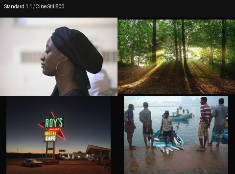

<details><summary>ค่าทั้งสูตรจากต้นฉบับ</summary>

```json
{
  "name": "CineStill800",
  "notes": "Tungsten cinema film: cool cast, red bloom (bloom_tint red: the glow's Cr spreads far more than its luma, docs/HALATION_RED.md section 8) plus red/orange light. Split: cyan shadows, warm highlights.",
  "kind": "colour",
  "hue": [
    0,
    0,
    -1,
    0,
    0,
    0,
    0,
    -2,
    -2,
    0,
    2,
    0
  ],
  "light": [
    0,
    0,
    2,
    2,
    0,
    0,
    -1,
    0,
    0,
    0,
    0,
    0
  ],
  "sat": [
    -1,
    0,
    2,
    3,
    0,
    0,
    2,
    2,
    2,
    -1,
    -2,
    -2
  ],
  "grain": "film",
  "wb": {
    "a_b": -2,
    "g_m": 0
  },
  "effect": {
    "type": "bloom",
    "strength": 4,
    "tint": "red"
  },
  "vignette": 0,
  "art_effect": "off",
  "tone": {
    "highlights": -1,
    "shadows": 2,
    "midtones": 0,
    "blacks": 0,
    "whites": -1
  },
  "advice": {
    "tone": {
      "highlights": -1,
      "shadows": 2,
      "midtones": 0
    }
  },
  "split": {
    "sh_color": 8,
    "sh": 1,
    "hl_color": 1,
    "hl": 1
  }
}
```

</details>

### Pro 400H

สีพาสเทล ผิวสว่างและเขียวอ่อน — Airy pastel negative: minty greens, light cyan skies. Split: green-cyan shade.

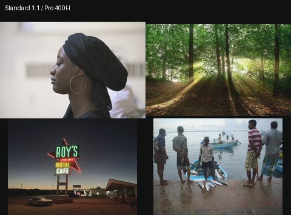

<details><summary>ค่าทั้งสูตรจากต้นฉบับ</summary>

```json
{
  "name": "Pro 400H",
  "notes": "Airy pastel negative: minty greens, light cyan skies. Split: green-cyan shade.",
  "kind": "colour",
  "hue": [
    0,
    0,
    0,
    0,
    0,
    0,
    0,
    0,
    0,
    2,
    3,
    3
  ],
  "light": [
    0,
    0,
    0,
    0,
    0,
    0,
    1,
    1,
    1,
    1,
    1,
    0
  ],
  "sat": [
    -2,
    -2,
    -2,
    -2,
    -2,
    -2,
    0,
    1,
    1,
    0,
    -1,
    -2
  ],
  "grain": "fine",
  "wb": null,
  "effect": {
    "type": "bloom",
    "strength": 1
  },
  "vignette": 0,
  "art_effect": "off",
  "tone": {
    "highlights": -2,
    "shadows": 3,
    "midtones": 2,
    "blacks": 1,
    "whites": -2
  },
  "advice": {
    "tone": {
      "highlights": -2,
      "shadows": 3,
      "midtones": 2
    },
    "contrast": -1
  },
  "split": {
    "sh_color": 9,
    "sh": 1,
    "hl_color": 0,
    "hl": 0
  }
}
```

</details>

### Faux IR

สีผิดธรรมชาติแบบอินฟราเรดจำลอง — Infrared-inspired false colour (golden/orange foliage, deep blue skies). Not true Aerochrome: the hue range can't turn green red. Sat advice: strong (+3..+5). Split: blue shadows, orange highlights.


<details><summary>ค่าทั้งสูตรจากต้นฉบับ</summary>

```json
{
  "name": "Faux IR",
  "notes": "Infrared-inspired false colour (golden/orange foliage, deep blue skies). Not true Aerochrome: the hue range can't turn green red. Sat advice: strong (+3..+5). Split: blue shadows, orange highlights.",
  "kind": "colour",
  "hue": [
    -7,
    3,
    5,
    7,
    7,
    7,
    0,
    3,
    7,
    -7,
    -7,
    -7
  ],
  "light": [
    1,
    2,
    2,
    2,
    0,
    0,
    -7,
    -3,
    -2,
    0,
    2,
    1
  ],
  "sat": [
    4,
    -1,
    2,
    3,
    3,
    3,
    2,
    5,
    5,
    3,
    5,
    5
  ],
  "grain": "fine",
  "wb": null,
  "effect": null,
  "vignette": 0,
  "art_effect": "off",
  "tone": {
    "highlights": 1,
    "shadows": -2,
    "midtones": 0,
    "blacks": -1,
    "whites": 0
  },
  "advice": {
    "tone": {
      "highlights": 1,
      "shadows": -2,
      "midtones": 0
    },
    "contrast": 2
  },
  "split": {
    "sh_color": 6,
    "sh": 1,
    "hl_color": 1,
    "hl": 1
  }
}
```

</details>

### Kodachrome25

สีสไลด์อุ่นและเข้ม — Kodachrome 25 slide (GarethB, mu-43): dense, rich reds, muted cyan/green, deep shadows. Advice: contrast +2, H-2 M+3 S-5. Split: slightly cool deep shadows.


<details><summary>ค่าทั้งสูตรจากต้นฉบับ</summary>

```json
{
  "name": "Kodachrome25",
  "notes": "Kodachrome 25 slide (GarethB, mu-43): dense, rich reds, muted cyan/green, deep shadows. Advice: contrast +2, H-2 M+3 S-5. Split: slightly cool deep shadows.",
  "kind": "colour",
  "hue": [
    0,
    0,
    0,
    0,
    0,
    0,
    -1,
    -1,
    0,
    0,
    -1,
    -1
  ],
  "light": [
    0,
    0,
    -1,
    -1,
    0,
    0,
    -1,
    -1,
    0,
    0,
    -1,
    -1
  ],
  "sat": [
    -2,
    1,
    1,
    -1,
    -1,
    2,
    -3,
    -2,
    -4,
    -4,
    -4,
    -5
  ],
  "grain": "off",
  "wb": {
    "a_b": 0,
    "g_m": 1
  },
  "effect": null,
  "vignette": 0,
  "art_effect": "off",
  "tone": {
    "highlights": -2,
    "shadows": -5,
    "midtones": 3,
    "blacks": -1,
    "whites": 0
  },
  "advice": {
    "tone": {
      "highlights": -2,
      "shadows": -5,
      "midtones": 3
    },
    "contrast": 2
  },
  "split": {
    "sh_color": 6,
    "sh": 1,
    "hl_color": 0,
    "hl": 0
  }
}
```

</details>

### Portra 160

สีผิวอ่อน คอนทราสต์เบา — Fine-grain portrait negative (I. Mitropoulos, om-recipes): natural skin, quiet greens, soft contrast.


<details><summary>ค่าทั้งสูตรจากต้นฉบับ</summary>

```json
{
  "name": "Portra 160",
  "notes": "Fine-grain portrait negative (I. Mitropoulos, om-recipes): natural skin, quiet greens, soft contrast.",
  "kind": "colour",
  "hue": [
    1,
    1,
    0,
    0,
    0,
    0,
    0,
    0,
    0,
    1,
    -1,
    -1
  ],
  "light": [
    1,
    1,
    1,
    0,
    0,
    0,
    0,
    0,
    0,
    0,
    0,
    0
  ],
  "sat": [
    -2,
    1,
    -1,
    -1,
    -2,
    -3,
    -1,
    -2,
    -2,
    -2,
    -3,
    -2
  ],
  "grain": "off",
  "wb": null,
  "effect": null,
  "vignette": 0,
  "art_effect": "off",
  "tone": {
    "highlights": -1,
    "shadows": 1,
    "midtones": 0,
    "blacks": 0,
    "whites": -1
  },
  "advice": {
    "tone": {
      "highlights": -1,
      "shadows": 1,
      "midtones": 0
    },
    "contrast": -1
  }
}
```

</details>

### Fujicolor200

โทนฟิล์มสีประจำวัน เขียวและฟ้าสมดุล — Fujicolor C200 (J. Bloomer, om-recipes): warm yellows, fresh greens, soft contrast. Split: green-yellow shadows.


<details><summary>ค่าทั้งสูตรจากต้นฉบับ</summary>

```json
{
  "name": "Fujicolor200",
  "notes": "Fujicolor C200 (J. Bloomer, om-recipes): warm yellows, fresh greens, soft contrast. Split: green-yellow shadows.",
  "kind": "colour",
  "hue": [
    0,
    0,
    0,
    0,
    0,
    0,
    0,
    0,
    0,
    0,
    -1,
    -1
  ],
  "light": [
    1,
    0,
    0,
    0,
    0,
    0,
    0,
    0,
    0,
    0,
    0,
    0
  ],
  "sat": [
    3,
    3,
    3,
    1,
    -1,
    -1,
    1,
    1,
    0,
    0,
    2,
    2
  ],
  "grain": "fine",
  "wb": {
    "a_b": 2,
    "g_m": 0
  },
  "effect": null,
  "vignette": 0,
  "art_effect": "off",
  "tone": {
    "highlights": 0,
    "shadows": -3,
    "midtones": 1,
    "blacks": 0,
    "whites": -1
  },
  "advice": {
    "tone": {
      "highlights": 0,
      "shadows": -3,
      "midtones": 1
    },
    "contrast": -1
  },
  "split": {
    "sh_color": 11,
    "sh": 1,
    "hl_color": 0,
    "hl": 0
  }
}
```

</details>

### Cuban Neg

สีอบอุ่น มีบุคลิกย้อนยุค — Inspired by Osan's Classic Cuban Neg: warm Classic Neg, golden cast (WB A+4), deep blues/reds, gritty grain, bloom 3. Sat: +2 warm, -2 greens. Split: golden highlights.


<details><summary>ค่าทั้งสูตรจากต้นฉบับ</summary>

```json
{
  "name": "Cuban Neg",
  "notes": "Inspired by Osan's Classic Cuban Neg: warm Classic Neg, golden cast (WB A+4), deep blues/reds, gritty grain, bloom 3. Sat: +2 warm, -2 greens. Split: golden highlights.",
  "kind": "colour",
  "hue": [
    0,
    -1,
    0,
    0,
    7,
    6,
    -4,
    -3,
    6,
    7,
    5,
    0
  ],
  "light": [
    -1,
    -2,
    -3,
    -3,
    -1,
    0,
    -1,
    -2,
    -2,
    -3,
    -5,
    -4
  ],
  "sat": [
    2,
    2,
    2,
    2,
    0,
    -2,
    1,
    1,
    1,
    -2,
    -1,
    0
  ],
  "grain": "fine",
  "wb": {
    "a_b": 3,
    "g_m": 0
  },
  "effect": {
    "type": "bloom",
    "strength": 3
  },
  "vignette": 0,
  "art_effect": "off",
  "tone": {
    "highlights": 1,
    "shadows": -3,
    "midtones": 1,
    "blacks": 0,
    "whites": -2
  },
  "advice": {
    "tone": {
      "highlights": 1,
      "shadows": -3,
      "midtones": 1
    },
    "contrast": 1
  },
  "split": {
    "sh_color": 0,
    "sh": 0,
    "hl_color": 0,
    "hl": 1
  }
}
```

</details>

### Cibachrome

สีเข้มและอิ่มแบบภาพอัดจากสไลด์ — Cibachrome print (Jay, om-recipes): glossy magenta-reds, deep blues, rich darks. Split: cool deep shadows.


<details><summary>ค่าทั้งสูตรจากต้นฉบับ</summary>

```json
{
  "name": "Cibachrome",
  "notes": "Cibachrome print (Jay, om-recipes): glossy magenta-reds, deep blues, rich darks. Split: cool deep shadows.",
  "kind": "colour",
  "hue": [
    0,
    0,
    0,
    -1,
    0,
    0,
    0,
    0,
    0,
    0,
    0,
    0
  ],
  "light": [
    0,
    0,
    -1,
    -1,
    0,
    0,
    -1,
    -1,
    -1,
    0,
    0,
    0
  ],
  "sat": [
    1,
    3,
    4,
    3,
    4,
    2,
    2,
    4,
    3,
    0,
    2,
    -1
  ],
  "grain": "off",
  "wb": {
    "a_b": 1,
    "g_m": -1
  },
  "effect": null,
  "vignette": 0,
  "art_effect": "off",
  "tone": {
    "highlights": -3,
    "shadows": -2,
    "midtones": 1,
    "blacks": -1,
    "whites": 1
  },
  "advice": {
    "tone": {
      "highlights": -3,
      "shadows": -2,
      "midtones": 1
    },
    "contrast": 1
  },
  "split": {
    "sh_color": 6,
    "sh": 1,
    "hl_color": 0,
    "hl": 0
  }
}
```

</details>

### UltraMax 400

โทนอุ่น สีชัดสำหรับถ่ายทั่วไป — Kodak consumer negative: warm, punchy reds/yellows, olive greens, visible grain. Split: yellow highlights, blue-violet shadows.


<details><summary>ค่าทั้งสูตรจากต้นฉบับ</summary>

```json
{
  "name": "UltraMax 400",
  "notes": "Kodak consumer negative: warm, punchy reds/yellows, olive greens, visible grain. Split: yellow highlights, blue-violet shadows.",
  "kind": "colour",
  "hue": [
    0,
    0,
    0,
    0,
    0,
    0,
    -1,
    -1,
    0,
    0,
    -2,
    -2
  ],
  "light": [
    1,
    0,
    0,
    -1,
    0,
    0,
    -1,
    -1,
    0,
    0,
    -1,
    0
  ],
  "sat": [
    3,
    2,
    2,
    2,
    0,
    -1,
    0,
    0,
    -1,
    -1,
    1,
    2
  ],
  "grain": "film",
  "wb": null,
  "effect": null,
  "vignette": 0,
  "art_effect": "off",
  "tone": {
    "highlights": 0,
    "shadows": -1,
    "midtones": 0,
    "blacks": 0,
    "whites": -1
  },
  "advice": {
    "tone": {
      "highlights": 0,
      "shadows": -1,
      "midtones": 0
    },
    "contrast": 1
  },
  "split": {
    "sh_color": 5,
    "sh": 1,
    "hl_color": 0,
    "hl": 1
  }
}
```

</details>

### Agfa Vista

สีสดแบบฟิล์มเนกาทีฟ — Agfa Vista 200: vivid magenta-leaning reds, deep blues, cool cheap-film punch. Split: red highlights.


<details><summary>ค่าทั้งสูตรจากต้นฉบับ</summary>

```json
{
  "name": "Agfa Vista",
  "notes": "Agfa Vista 200: vivid magenta-leaning reds, deep blues, cool cheap-film punch. Split: red highlights.",
  "kind": "colour",
  "hue": [
    0,
    0,
    -1,
    -1,
    0,
    0,
    0,
    0,
    0,
    0,
    1,
    0
  ],
  "light": [
    0,
    0,
    -1,
    -1,
    0,
    0,
    -1,
    -1,
    0,
    0,
    0,
    0
  ],
  "sat": [
    1,
    1,
    3,
    4,
    2,
    0,
    1,
    1,
    0,
    -1,
    0,
    0
  ],
  "grain": "fine",
  "wb": {
    "a_b": 0,
    "g_m": -1
  },
  "effect": null,
  "vignette": 0,
  "art_effect": "off",
  "tone": {
    "highlights": 0,
    "shadows": -1,
    "midtones": 0,
    "blacks": 0,
    "whites": -1
  },
  "advice": {
    "tone": {
      "highlights": 0,
      "shadows": -1,
      "midtones": 0
    },
    "contrast": 1
  },
  "split": {
    "sh_color": 0,
    "sh": 0,
    "hl_color": 3,
    "hl": 1
  }
}
```

</details>

### CineStill50D

โทนภาพยนตร์กลางวัน — Daylight cinema stock: clean, slightly cool, rich blues, soft highlights, faint red glow.


<details><summary>ค่าทั้งสูตรจากต้นฉบับ</summary>

```json
{
  "name": "CineStill50D",
  "notes": "Daylight cinema stock: clean, slightly cool, rich blues, soft highlights, faint red glow.",
  "kind": "colour",
  "hue": [
    0,
    0,
    0,
    0,
    0,
    0,
    0,
    -1,
    -1,
    1,
    1,
    0
  ],
  "light": [
    1,
    0,
    0,
    0,
    0,
    0,
    -1,
    -1,
    0,
    0,
    0,
    0
  ],
  "sat": [
    0,
    0,
    0,
    0,
    0,
    0,
    2,
    2,
    1,
    -1,
    -1,
    -1
  ],
  "grain": "fine",
  "wb": {
    "a_b": -1,
    "g_m": 0
  },
  "effect": {
    "type": "bloom",
    "strength": 2,
    "tint": "red"
  },
  "vignette": 0,
  "art_effect": "off",
  "tone": {
    "highlights": -2,
    "shadows": 2,
    "midtones": 0,
    "blacks": 0,
    "whites": -2
  },
  "advice": {
    "tone": {
      "highlights": -2,
      "shadows": 2,
      "midtones": 0
    },
    "contrast": -1
  }
}
```

</details>

### Vision3 250D

โทนภาพยนตร์แสงกลางวัน — Kodak daylight cinema negative: flat, wide latitude, gentle teal/orange separation. Split: cyan shadows, warm highlights.


<details><summary>ค่าทั้งสูตรจากต้นฉบับ</summary>

```json
{
  "name": "Vision3 250D",
  "notes": "Kodak daylight cinema negative: flat, wide latitude, gentle teal/orange separation. Split: cyan shadows, warm highlights.",
  "kind": "colour",
  "hue": [
    0,
    1,
    0,
    0,
    0,
    0,
    -1,
    -2,
    -1,
    1,
    1,
    0
  ],
  "light": [
    0,
    0,
    0,
    0,
    0,
    0,
    -1,
    -1,
    0,
    0,
    -1,
    -1
  ],
  "sat": [
    -1,
    0,
    0,
    -1,
    -2,
    -2,
    -1,
    -1,
    -1,
    -2,
    -2,
    -2
  ],
  "grain": "fine",
  "wb": null,
  "effect": null,
  "vignette": 0,
  "art_effect": "off",
  "tone": {
    "highlights": -3,
    "shadows": 3,
    "midtones": 0,
    "blacks": 1,
    "whites": -1
  },
  "advice": {
    "tone": {
      "highlights": -3,
      "shadows": 3,
      "midtones": 0
    },
    "contrast": -2
  },
  "split": {
    "sh_color": 8,
    "sh": 1,
    "hl_color": 1,
    "hl": 1
  }
}
```

</details>

### Vision3 500T

โทนภาพยนตร์แสงทังสเตน — Tungsten cinema negative in daylight: cool teal cast, warm lights, open shadows. Split: cyan shadows, warm highlights.

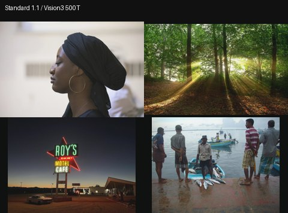

<details><summary>ค่าทั้งสูตรจากต้นฉบับ</summary>

```json
{
  "name": "Vision3 500T",
  "notes": "Tungsten cinema negative in daylight: cool teal cast, warm lights, open shadows. Split: cyan shadows, warm highlights.",
  "kind": "colour",
  "hue": [
    0,
    1,
    0,
    0,
    0,
    0,
    0,
    -2,
    -2,
    1,
    2,
    0
  ],
  "light": [
    0,
    1,
    1,
    0,
    0,
    0,
    -1,
    0,
    0,
    0,
    -1,
    -1
  ],
  "sat": [
    -1,
    0,
    1,
    1,
    -1,
    -1,
    1,
    1,
    1,
    -1,
    -2,
    -2
  ],
  "grain": "film",
  "wb": {
    "a_b": -1,
    "g_m": 0
  },
  "effect": null,
  "vignette": 0,
  "art_effect": "off",
  "tone": {
    "highlights": -2,
    "shadows": 3,
    "midtones": 0,
    "blacks": 1,
    "whites": -1
  },
  "advice": {
    "tone": {
      "highlights": -2,
      "shadows": 3,
      "midtones": 0
    },
    "contrast": -1
  },
  "split": {
    "sh_color": 8,
    "sh": 1,
    "hl_color": 1,
    "hl": 1
  }
}
```

</details>

### Polaroid

สีจางและดำยกแบบภาพทันใจ — Integral instant film: punchy, narrow dynamic range (bright highlights, deep shadows), pink highlights, green shadows.


<details><summary>ค่าทั้งสูตรจากต้นฉบับ</summary>

```json
{
  "name": "Polaroid",
  "notes": "Integral instant film: punchy, narrow dynamic range (bright highlights, deep shadows), pink highlights, green shadows.",
  "kind": "colour",
  "hue": [
    1,
    1,
    0,
    0,
    0,
    0,
    -1,
    -1,
    0,
    1,
    2,
    1
  ],
  "light": [
    1,
    1,
    1,
    0,
    0,
    0,
    1,
    1,
    1,
    1,
    0,
    0
  ],
  "sat": [
    -1,
    -1,
    -2,
    -2,
    -2,
    -2,
    -3,
    -3,
    -2,
    -1,
    -2,
    -1
  ],
  "grain": "fine",
  "wb": {
    "a_b": 1,
    "g_m": 1
  },
  "effect": {
    "type": "bloom",
    "strength": 2,
    "tint": "warm"
  },
  "vignette": 0,
  "art_effect": "off",
  "tone": {
    "highlights": 2,
    "shadows": -3,
    "midtones": 0,
    "blacks": -1,
    "whites": 1
  },
  "advice": {
    "tone": {
      "highlights": 2,
      "shadows": -3,
      "midtones": 0
    },
    "contrast": 1
  },
  "split": {
    "sh_color": 10,
    "sh": 1,
    "hl_color": 4,
    "hl": 1
  }
}
```

</details>

### Cross Proc.

สีเพี้ยนและคอนทราสต์เฉพาะตัว — E-6 slide in C-41: hard contrast, yellow-green highlights, cyan skies, yellowed skin.


<details><summary>ค่าทั้งสูตรจากต้นฉบับ</summary>

```json
{
  "name": "Cross Proc.",
  "notes": "E-6 slide in C-41: hard contrast, yellow-green highlights, cyan skies, yellowed skin.",
  "kind": "colour",
  "hue": [
    -2,
    0,
    0,
    -1,
    -2,
    -1,
    -2,
    -3,
    -2,
    -3,
    -3,
    -3
  ],
  "light": [
    2,
    1,
    0,
    -1,
    -1,
    0,
    -1,
    -1,
    0,
    0,
    0,
    1
  ],
  "sat": [
    3,
    2,
    2,
    3,
    1,
    0,
    2,
    3,
    3,
    2,
    3,
    4
  ],
  "grain": "film",
  "wb": {
    "a_b": 1,
    "g_m": 1
  },
  "effect": null,
  "vignette": 0,
  "art_effect": "off",
  "tone": {
    "highlights": 2,
    "shadows": -3,
    "midtones": 0,
    "blacks": -1,
    "whites": 1
  },
  "advice": {
    "tone": {
      "highlights": 2,
      "shadows": -3,
      "midtones": 0
    },
    "contrast": 2
  },
  "split": {
    "sh_color": 0,
    "sh": 0,
    "hl_color": 11,
    "hl": 2
  }
}
```

</details>

### Atrophy

สีเก่าและซีดจาง — Inspired by GxAce's Atrophy: urban-decay grade, near-grey base, muted greens/skies, rust and reds kept, gritty clarity. Sat advice: greens/blues -4..-5. Split: teal-grey shadows, rusty highlights.


<details><summary>ค่าทั้งสูตรจากต้นฉบับ</summary>

```json
{
  "name": "Atrophy",
  "notes": "Inspired by GxAce's Atrophy: urban-decay grade, near-grey base, muted greens/skies, rust and reds kept, gritty clarity. Sat advice: greens/blues -4..-5. Split: teal-grey shadows, rusty highlights.",
  "kind": "colour",
  "hue": [
    -2,
    -1,
    0,
    0,
    2,
    1,
    -2,
    -1,
    0,
    2,
    2,
    -1
  ],
  "light": [
    -1,
    0,
    -1,
    -1,
    -1,
    -1,
    -2,
    -2,
    -1,
    -2,
    -3,
    -2
  ],
  "sat": [
    -2,
    -1,
    1,
    1,
    -3,
    -4,
    -4,
    -4,
    -4,
    -5,
    -5,
    -5
  ],
  "grain": "fine",
  "wb": null,
  "effect": {
    "type": "clarity",
    "strength": 3
  },
  "vignette": 0,
  "art_effect": "off",
  "tone": {
    "highlights": -1,
    "shadows": -2,
    "midtones": 0,
    "blacks": 1,
    "whites": -1
  },
  "advice": {
    "tone": {
      "highlights": -1,
      "shadows": -2,
      "midtones": 0
    },
    "contrast": 1
  },
  "split": {
    "sh_color": 9,
    "sh": 1,
    "hl_color": 2,
    "hl": 1
  }
}
```

</details>

### Acros

ขาวดำไล่น้ำหนักนุ่ม — Fine-grain mono: deep blacks, smooth tones, darker reds.


<details><summary>ค่าทั้งสูตรจากต้นฉบับ</summary>

```json
{
  "name": "Acros",
  "notes": "Fine-grain mono: deep blacks, smooth tones, darker reds.",
  "kind": "mono",
  "hue": [
    0,
    0,
    0,
    0,
    0,
    0,
    0,
    0,
    0,
    0,
    0,
    0
  ],
  "light": [
    0,
    0,
    0,
    0,
    0,
    0,
    0,
    0,
    0,
    0,
    0,
    0
  ],
  "sat": [
    0,
    0,
    0,
    0,
    0,
    0,
    0,
    0,
    0,
    0,
    0,
    0
  ],
  "grain": "fine",
  "wb": null,
  "effect": null,
  "vignette": 0,
  "art_effect": "off",
  "tone": {
    "highlights": 0,
    "shadows": 0,
    "midtones": 0,
    "blacks": 0,
    "whites": 0
  },
  "advice": {
    "tone": {
      "highlights": -1,
      "shadows": -2,
      "midtones": 0
    },
    "contrast": 1,
    "mono_filter": {
      "colour": "green",
      "strength": 1
    }
  }
}
```

</details>

### Tri-X 400

ขาวดำคอนทราสต์ชัด — Classic gritty reportage mono: punchy contrast, darker skies.


<details><summary>ค่าทั้งสูตรจากต้นฉบับ</summary>

```json
{
  "name": "Tri-X 400",
  "notes": "Classic gritty reportage mono: punchy contrast, darker skies.",
  "kind": "mono",
  "hue": [
    0,
    0,
    0,
    0,
    0,
    0,
    0,
    0,
    0,
    0,
    0,
    0
  ],
  "light": [
    0,
    0,
    0,
    0,
    0,
    0,
    0,
    0,
    0,
    0,
    0,
    0
  ],
  "sat": [
    0,
    0,
    0,
    0,
    0,
    0,
    0,
    0,
    0,
    0,
    0,
    0
  ],
  "grain": "film",
  "wb": null,
  "effect": null,
  "vignette": 0,
  "art_effect": "off",
  "tone": {
    "highlights": 0,
    "shadows": 0,
    "midtones": 0,
    "blacks": 0,
    "whites": 0
  },
  "advice": {
    "tone": {
      "highlights": -1,
      "shadows": -3,
      "midtones": 0
    },
    "contrast": 2,
    "mono_filter": {
      "colour": "yellow",
      "strength": 2
    }
  }
}
```

</details>

### HP5 Plus

ขาวดำใช้งานทั่วไป มีน้ำหนักกลาง — Soft, grainy mono with wide latitude and open shadows.


<details><summary>ค่าทั้งสูตรจากต้นฉบับ</summary>

```json
{
  "name": "HP5 Plus",
  "notes": "Soft, grainy mono with wide latitude and open shadows.",
  "kind": "mono",
  "hue": [
    0,
    0,
    0,
    0,
    0,
    0,
    0,
    0,
    0,
    0,
    0,
    0
  ],
  "light": [
    0,
    0,
    0,
    0,
    0,
    0,
    0,
    0,
    0,
    0,
    0,
    0
  ],
  "sat": [
    0,
    0,
    0,
    0,
    0,
    0,
    0,
    0,
    0,
    0,
    0,
    0
  ],
  "grain": "film",
  "wb": null,
  "effect": null,
  "vignette": 0,
  "art_effect": "off",
  "tone": {
    "highlights": 0,
    "shadows": 0,
    "midtones": 0,
    "blacks": 0,
    "whites": 0
  },
  "advice": {
    "tone": {
      "highlights": -2,
      "shadows": 1,
      "midtones": 0
    },
    "mono_filter": {
      "colour": "none",
      "strength": 1
    }
  }
}
```

</details>

## Standard 1.0

### Velvia

สีสด ฟ้าและเขียวเข้ม เงาลึก — Saturated landscape slide film: deep skies, dense greens, crushed shadows.


<details><summary>ค่าทั้งสูตรจากต้นฉบับ</summary>

```json
{
  "name": "Velvia",
  "notes": "Saturated landscape slide film: deep skies, dense greens, crushed shadows.",
  "kind": "colour",
  "hue": [
    0,
    0,
    0,
    -1,
    -1,
    -1,
    1,
    2,
    2,
    -2,
    0,
    0
  ],
  "light": [
    0,
    0,
    0,
    0,
    0,
    0,
    -2,
    -2,
    -1,
    0,
    -1,
    -1
  ],
  "sat": [
    4,
    4,
    4,
    5,
    3,
    4,
    5,
    5,
    3,
    3,
    4,
    4
  ],
  "grain": "off",
  "wb": null,
  "effect": null,
  "vignette": 0,
  "art_effect": "off",
  "tone": {
    "highlights": 1,
    "shadows": -4,
    "midtones": 0,
    "blacks": -2,
    "whites": 1
  },
  "advice": {
    "tone": {
      "highlights": 1,
      "shadows": -4,
      "midtones": 0
    },
    "contrast": 2
  }
}
```

</details>

### Astia

นุ่มนวล สีผิวสะอาด ฟ้าชัดขึ้นเล็กน้อย — Soft slide film: gentle contrast, clean skin, slightly richer skies.


<details><summary>ค่าทั้งสูตรจากต้นฉบับ</summary>

```json
{
  "name": "Astia",
  "notes": "Soft slide film: gentle contrast, clean skin, slightly richer skies.",
  "kind": "colour",
  "hue": [
    0,
    1,
    0,
    0,
    0,
    0,
    0,
    1,
    2,
    1,
    -1,
    -1
  ],
  "light": [
    1,
    1,
    1,
    0,
    0,
    0,
    0,
    0,
    0,
    0,
    0,
    0
  ],
  "sat": [
    0,
    -1,
    -1,
    0,
    0,
    1,
    1,
    1,
    0,
    -1,
    -1,
    0
  ],
  "grain": "off",
  "wb": null,
  "effect": null,
  "vignette": 0,
  "art_effect": "off",
  "tone": {
    "highlights": -2,
    "shadows": 1,
    "midtones": 0,
    "blacks": 0,
    "whites": 0
  },
  "advice": {
    "tone": {
      "highlights": -2,
      "shadows": 1,
      "midtones": 0
    },
    "contrast": -1
  }
}
```

</details>

### Cl. Chrome

สีหม่น คอนทราสต์แบบภาพสารคดี — Documentary look: muted greens and yellows, cyan skies, hard shadows.


<details><summary>ค่าทั้งสูตรจากต้นฉบับ</summary>

```json
{
  "name": "Cl. Chrome",
  "notes": "Documentary look: muted greens and yellows, cyan skies, hard shadows.",
  "kind": "colour",
  "hue": [
    -2,
    -1,
    0,
    0,
    3,
    1,
    -2,
    -4,
    -2,
    2,
    0,
    -2
  ],
  "light": [
    -1,
    -1,
    0,
    -1,
    -1,
    -1,
    -1,
    -1,
    -1,
    -1,
    -2,
    -1
  ],
  "sat": [
    -2,
    -1,
    -1,
    -1,
    -1,
    -3,
    -3,
    -3,
    -1,
    -3,
    -4,
    -4
  ],
  "grain": "off",
  "wb": null,
  "effect": null,
  "vignette": 0,
  "art_effect": "off",
  "tone": {
    "highlights": 0,
    "shadows": -3,
    "midtones": 0,
    "blacks": -1,
    "whites": 0
  },
  "advice": {
    "tone": {
      "highlights": 0,
      "shadows": -3,
      "midtones": 0
    },
    "contrast": 1
  }
}
```

</details>

### Classic Neg

สีแยกชัด เงาอมเย็นและอุ่นในส่วนสว่าง — Superia-style negative: teal-green cast, punchy mids, light skies.


<details><summary>ค่าทั้งสูตรจากต้นฉบับ</summary>

```json
{
  "name": "Classic Neg",
  "notes": "Superia-style negative: teal-green cast, punchy mids, light skies.",
  "kind": "colour",
  "hue": [
    0,
    -1,
    0,
    0,
    7,
    6,
    -4,
    -3,
    6,
    7,
    5,
    0
  ],
  "light": [
    -2,
    -3,
    -3,
    -2,
    -1,
    1,
    1,
    1,
    -1,
    -3,
    -5,
    -4
  ],
  "sat": [
    -3,
    -2,
    -2,
    0,
    -1,
    -5,
    -2,
    -2,
    -1,
    -4,
    -4,
    -4
  ],
  "grain": "fine",
  "wb": null,
  "effect": null,
  "vignette": 0,
  "art_effect": "off",
  "tone": {
    "highlights": 4,
    "shadows": -2,
    "midtones": 1,
    "blacks": 0,
    "whites": -1
  },
  "advice": {
    "tone": {
      "highlights": 4,
      "shadows": -2,
      "midtones": 1
    },
    "contrast": 2
  }
}
```

</details>

### Provia 400

สีสมดุลแบบสไลด์ คอนทราสต์ปานกลาง — Fujichrome Provia 400X slide: magenta-red cast, lavender skies, rich blues, deep reds, dark greens, fast fall to black, fine grain. Advice: contrast +1.


<details><summary>ค่าทั้งสูตรจากต้นฉบับ</summary>

```json
{
  "name": "Provia 400",
  "notes": "Fujichrome Provia 400X slide: magenta-red cast, lavender skies, rich blues, deep reds, dark greens, fast fall to black, fine grain. Advice: contrast +1.",
  "kind": "colour",
  "hue": [
    -3,
    -2,
    -2,
    0,
    0,
    0,
    1,
    0,
    0,
    0,
    0,
    0
  ],
  "light": [
    0,
    0,
    0,
    -1,
    0,
    0,
    -1,
    -1,
    0,
    -1,
    -2,
    -1
  ],
  "sat": [
    0,
    1,
    1,
    1,
    0,
    1,
    2,
    2,
    1,
    0,
    0,
    0
  ],
  "grain": "fine",
  "wb": {
    "a_b": 0,
    "g_m": -3
  },
  "effect": null,
  "vignette": 0,
  "art_effect": "off",
  "tone": {
    "highlights": 0,
    "shadows": -1,
    "midtones": -1,
    "blacks": -1,
    "whites": -3
  },
  "advice": {
    "tone": {
      "highlights": 0,
      "shadows": -1,
      "midtones": -1
    },
    "contrast": 1
  }
}
```

</details>

### Reala Ace

สีเป็นธรรมชาติและแยกเฉดชัด — Accurate, crisp modern negative: true hues, restrained greens.


<details><summary>ค่าทั้งสูตรจากต้นฉบับ</summary>

```json
{
  "name": "Reala Ace",
  "notes": "Accurate, crisp modern negative: true hues, restrained greens.",
  "kind": "colour",
  "hue": [
    0,
    0,
    0,
    0,
    0,
    0,
    0,
    0,
    0,
    0,
    -1,
    -2
  ],
  "light": [
    0,
    -1,
    -1,
    -1,
    -1,
    -1,
    -3,
    -3,
    -3,
    -1,
    0,
    0
  ],
  "sat": [
    0,
    0,
    0,
    0,
    -1,
    -1,
    0,
    -1,
    -2,
    -3,
    -3,
    -2
  ],
  "grain": "off",
  "wb": null,
  "effect": null,
  "vignette": 0,
  "art_effect": "off",
  "tone": {
    "highlights": 3,
    "shadows": 1,
    "midtones": 0,
    "blacks": 0,
    "whites": -1
  },
  "advice": {
    "tone": {
      "highlights": 3,
      "shadows": 1,
      "midtones": 0
    },
    "contrast": 1
  }
}
```

</details>

### Eterna

โทนภาพยนตร์นุ่ม สีไม่จัด ไฮไลต์อ่อน — Cinema negative: flat, open shadows, quiet teal-leaning colour.


<details><summary>ค่าทั้งสูตรจากต้นฉบับ</summary>

```json
{
  "name": "Eterna",
  "notes": "Cinema negative: flat, open shadows, quiet teal-leaning colour.",
  "kind": "colour",
  "hue": [
    0,
    3,
    2,
    0,
    0,
    0,
    -2,
    -6,
    -4,
    0,
    -1,
    -2
  ],
  "light": [
    -1,
    -1,
    -2,
    -3,
    -3,
    -2,
    -2,
    -1,
    -1,
    -1,
    -1,
    -1
  ],
  "sat": [
    -2,
    -2,
    -3,
    -2,
    -2,
    -3,
    -4,
    -5,
    -2,
    -3,
    -3,
    -3
  ],
  "grain": "off",
  "wb": null,
  "effect": null,
  "vignette": 0,
  "art_effect": "off",
  "tone": {
    "highlights": -2,
    "shadows": 4,
    "midtones": 0,
    "blacks": 1,
    "whites": -1
  },
  "advice": {
    "tone": {
      "highlights": -2,
      "shadows": 4,
      "midtones": 0
    },
    "contrast": -2
  }
}
```

</details>

### Bleach Byp.

ลดสีและเพิ่มคอนทราสต์ — Silver-retained cinema look: near-monochrome, harsh contrast.

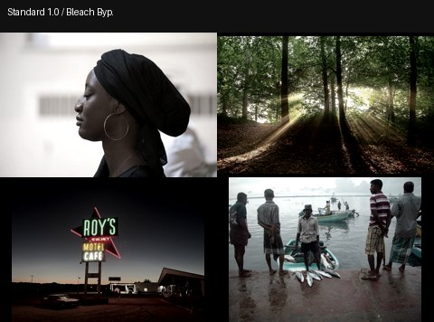

<details><summary>ค่าทั้งสูตรจากต้นฉบับ</summary>

```json
{
  "name": "Bleach Byp.",
  "notes": "Silver-retained cinema look: near-monochrome, harsh contrast.",
  "kind": "colour",
  "hue": [
    0,
    0,
    -2,
    -3,
    0,
    0,
    -3,
    -7,
    -5,
    0,
    0,
    0
  ],
  "light": [
    -2,
    -3,
    -4,
    -5,
    -4,
    -3,
    -1,
    -1,
    -1,
    -2,
    -3,
    -2
  ],
  "sat": [
    -5,
    -5,
    -5,
    -5,
    -5,
    -5,
    -5,
    -5,
    -5,
    -5,
    -5,
    -5
  ],
  "grain": "fine",
  "wb": null,
  "effect": null,
  "vignette": 0,
  "art_effect": "off",
  "tone": {
    "highlights": 4,
    "shadows": -3,
    "midtones": 0,
    "blacks": -2,
    "whites": 1
  },
  "advice": {
    "tone": {
      "highlights": 4,
      "shadows": -3,
      "midtones": 0
    },
    "contrast": 2
  }
}
```

</details>

### Kodachrome64

สีอบอุ่น แดงเด่น เงาลึก — Rich deep reds, golden yellows, dense cyan-blue skies, olive greens.

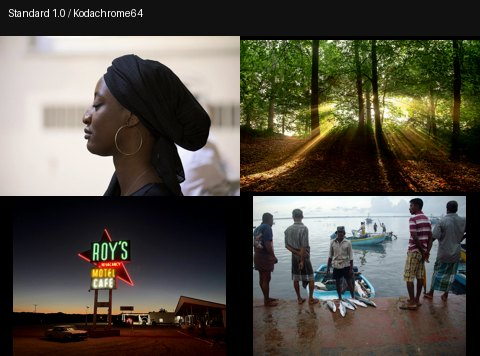

<details><summary>ค่าทั้งสูตรจากต้นฉบับ</summary>

```json
{
  "name": "Kodachrome64",
  "notes": "Rich deep reds, golden yellows, dense cyan-blue skies, olive greens.",
  "kind": "colour",
  "hue": [
    0,
    0,
    0,
    0,
    1,
    0,
    -1,
    -2,
    -1,
    1,
    -1,
    -1
  ],
  "light": [
    -1,
    -2,
    -2,
    -2,
    -1,
    -1,
    -2,
    -1,
    -1,
    -1,
    -2,
    -2
  ],
  "sat": [
    1,
    1,
    2,
    2,
    0,
    -1,
    1,
    1,
    0,
    -1,
    -1,
    0
  ],
  "grain": "fine",
  "wb": {
    "a_b": 1,
    "g_m": 0
  },
  "effect": null,
  "vignette": 0,
  "art_effect": "off",
  "tone": {
    "highlights": -1,
    "shadows": -2,
    "midtones": 0,
    "blacks": -1,
    "whites": 1
  },
  "advice": {
    "tone": {
      "highlights": -1,
      "shadows": -2,
      "midtones": 0
    },
    "contrast": 2
  }
}
```

</details>

### Portra 400

ผิวนุ่ม สีอุ่น ไฮไลต์นุ่ม — Warm pastel portrait negative: glowing skin, soft contrast.


<details><summary>ค่าทั้งสูตรจากต้นฉบับ</summary>

```json
{
  "name": "Portra 400",
  "notes": "Warm pastel portrait negative: glowing skin, soft contrast.",
  "kind": "colour",
  "hue": [
    1,
    1,
    0,
    0,
    0,
    0,
    1,
    0,
    0,
    0,
    -2,
    -2
  ],
  "light": [
    1,
    1,
    1,
    0,
    0,
    0,
    -1,
    0,
    0,
    0,
    0,
    0
  ],
  "sat": [
    -1,
    0,
    0,
    -1,
    -1,
    -2,
    -2,
    -2,
    -2,
    -3,
    -3,
    -2
  ],
  "grain": "fine",
  "wb": {
    "a_b": 1,
    "g_m": 0
  },
  "effect": {
    "type": "bloom",
    "strength": 1,
    "tint": "warm"
  },
  "vignette": 0,
  "art_effect": "off",
  "tone": {
    "highlights": -2,
    "shadows": 2,
    "midtones": 1,
    "blacks": 0,
    "whites": -2
  },
  "advice": {
    "tone": {
      "highlights": -2,
      "shadows": 2,
      "midtones": 1
    },
    "contrast": -1
  }
}
```

</details>

### Ektar 100

สีสด รายละเอียดฟ้าและเขียวเด่น — Ultra-vivid fine-grain negative: saturated reds and blues.


<details><summary>ค่าทั้งสูตรจากต้นฉบับ</summary>

```json
{
  "name": "Ektar 100",
  "notes": "Ultra-vivid fine-grain negative: saturated reds and blues.",
  "kind": "colour",
  "hue": [
    0,
    0,
    0,
    1,
    0,
    0,
    0,
    1,
    1,
    0,
    0,
    0
  ],
  "light": [
    0,
    0,
    -1,
    -1,
    0,
    0,
    -2,
    -2,
    -1,
    0,
    0,
    0
  ],
  "sat": [
    1,
    2,
    3,
    3,
    2,
    1,
    4,
    4,
    2,
    0,
    1,
    1
  ],
  "grain": "off",
  "wb": null,
  "effect": null,
  "vignette": 0,
  "art_effect": "off",
  "tone": {
    "highlights": 0,
    "shadows": -1,
    "midtones": 0,
    "blacks": 0,
    "whites": -1
  },
  "advice": {
    "tone": {
      "highlights": 0,
      "shadows": -1,
      "midtones": 0
    },
    "contrast": 2
  }
}
```

</details>

### Gold 200

เหลืองอุ่นแบบฟิล์มถ่ายทั่วไป — Golden consumer negative: sunny yellows, muted cyan skies.


<details><summary>ค่าทั้งสูตรจากต้นฉบับ</summary>

```json
{
  "name": "Gold 200",
  "notes": "Golden consumer negative: sunny yellows, muted cyan skies.",
  "kind": "colour",
  "hue": [
    0,
    0,
    0,
    0,
    0,
    0,
    0,
    0,
    0,
    0,
    -2,
    -2
  ],
  "light": [
    2,
    1,
    0,
    0,
    0,
    0,
    0,
    0,
    0,
    0,
    0,
    0
  ],
  "sat": [
    4,
    2,
    0,
    0,
    -1,
    -1,
    -2,
    -2,
    -3,
    -2,
    0,
    2
  ],
  "grain": "fine",
  "wb": {
    "a_b": 2,
    "g_m": 0
  },
  "effect": {
    "type": "bloom",
    "strength": 1,
    "tint": "amber"
  },
  "vignette": 0,
  "art_effect": "off",
  "tone": {
    "highlights": -1,
    "shadows": 0,
    "midtones": 1,
    "blacks": 0,
    "whites": -1
  },
  "advice": {
    "tone": {
      "highlights": -1,
      "shadows": 0,
      "midtones": 1
    }
  }
}
```

</details>

### Ektachrome

ลักษณะสไลด์ โทนเย็นและสีสะอาด — Clean, cool slide film: neutral skin, bright saturated blues.


<details><summary>ค่าทั้งสูตรจากต้นฉบับ</summary>

```json
{
  "name": "Ektachrome",
  "notes": "Clean, cool slide film: neutral skin, bright saturated blues.",
  "kind": "colour",
  "hue": [
    0,
    0,
    0,
    0,
    0,
    0,
    1,
    0,
    1,
    0,
    0,
    0
  ],
  "light": [
    0,
    0,
    0,
    0,
    0,
    0,
    -1,
    -1,
    0,
    0,
    0,
    0
  ],
  "sat": [
    0,
    -1,
    0,
    0,
    2,
    3,
    4,
    4,
    3,
    1,
    1,
    0
  ],
  "grain": "off",
  "wb": {
    "a_b": -1,
    "g_m": 0
  },
  "effect": null,
  "vignette": 0,
  "art_effect": "off",
  "tone": {
    "highlights": 0,
    "shadows": -2,
    "midtones": 0,
    "blacks": -1,
    "whites": 1
  },
  "advice": {
    "tone": {
      "highlights": 0,
      "shadows": -2,
      "midtones": 0
    },
    "contrast": 1
  }
}
```

</details>

### CineStill800

กลางคืน แสงไฟอุ่นและเงาเย็น — Tungsten cinema film: cool cast, red bloom (bloom + bloom_tint red: the glow's Cr spreads far more than its luma, docs/HALATION_RED.md section 8) plus red/orange light.


<details><summary>ค่าทั้งสูตรจากต้นฉบับ</summary>

```json
{
  "name": "CineStill800",
  "notes": "Tungsten cinema film: cool cast, red bloom (bloom + bloom_tint red: the glow's Cr spreads far more than its luma, docs/HALATION_RED.md section 8) plus red/orange light.",
  "kind": "colour",
  "hue": [
    0,
    0,
    -1,
    0,
    0,
    0,
    0,
    -2,
    -2,
    0,
    2,
    0
  ],
  "light": [
    0,
    0,
    2,
    2,
    0,
    0,
    -1,
    0,
    0,
    0,
    0,
    0
  ],
  "sat": [
    -1,
    0,
    2,
    3,
    0,
    0,
    2,
    2,
    2,
    -1,
    -2,
    -2
  ],
  "grain": "film",
  "wb": {
    "a_b": -3,
    "g_m": 0
  },
  "effect": {
    "type": "bloom",
    "strength": 4,
    "tint": "red"
  },
  "vignette": 0,
  "art_effect": "off",
  "tone": {
    "highlights": -1,
    "shadows": 2,
    "midtones": 0,
    "blacks": 0,
    "whites": -1
  },
  "advice": {
    "tone": {
      "highlights": -1,
      "shadows": 2,
      "midtones": 0
    }
  }
}
```

</details>

### Pro 400H

สีพาสเทล ผิวสว่างและเขียวอ่อน — Airy pastel negative: minty greens, light cyan skies.


<details><summary>ค่าทั้งสูตรจากต้นฉบับ</summary>

```json
{
  "name": "Pro 400H",
  "notes": "Airy pastel negative: minty greens, light cyan skies.",
  "kind": "colour",
  "hue": [
    0,
    0,
    0,
    0,
    0,
    0,
    0,
    0,
    0,
    2,
    3,
    3
  ],
  "light": [
    0,
    0,
    0,
    0,
    0,
    0,
    1,
    1,
    1,
    1,
    1,
    0
  ],
  "sat": [
    -2,
    -2,
    -2,
    -2,
    -2,
    -2,
    0,
    1,
    1,
    0,
    -1,
    -2
  ],
  "grain": "fine",
  "wb": {
    "a_b": -1,
    "g_m": 0
  },
  "effect": {
    "type": "bloom",
    "strength": 1
  },
  "vignette": 0,
  "art_effect": "off",
  "tone": {
    "highlights": -2,
    "shadows": 3,
    "midtones": 2,
    "blacks": 1,
    "whites": -2
  },
  "advice": {
    "tone": {
      "highlights": -2,
      "shadows": 3,
      "midtones": 2
    },
    "contrast": -1
  }
}
```

</details>

### Faux IR

สีผิดธรรมชาติแบบอินฟราเรดจำลอง — Infrared-inspired false colour (golden/orange foliage, deep blue skies). Not true Aerochrome: the hue range can't turn green red. Sat advice: strong (+3..+5).


<details><summary>ค่าทั้งสูตรจากต้นฉบับ</summary>

```json
{
  "name": "Faux IR",
  "notes": "Infrared-inspired false colour (golden/orange foliage, deep blue skies). Not true Aerochrome: the hue range can't turn green red. Sat advice: strong (+3..+5).",
  "kind": "colour",
  "hue": [
    -7,
    3,
    5,
    7,
    7,
    7,
    0,
    3,
    7,
    -7,
    -7,
    -7
  ],
  "light": [
    1,
    2,
    2,
    2,
    0,
    0,
    -7,
    -3,
    -2,
    0,
    2,
    1
  ],
  "sat": [
    4,
    -1,
    2,
    3,
    3,
    3,
    2,
    5,
    5,
    3,
    5,
    5
  ],
  "grain": "fine",
  "wb": null,
  "effect": null,
  "vignette": 0,
  "art_effect": "off",
  "tone": {
    "highlights": 1,
    "shadows": -2,
    "midtones": 0,
    "blacks": -1,
    "whites": 0
  },
  "advice": {
    "tone": {
      "highlights": 1,
      "shadows": -2,
      "midtones": 0
    },
    "contrast": 2
  }
}
```

</details>

### Kodachrome25

สีสไลด์อุ่นและเข้ม — Kodachrome 25 slide (GarethB, mu-43): dense, rich reds, muted cyan/green, deep shadows. Advice: contrast +2, H-2 M+3 S-5.


<details><summary>ค่าทั้งสูตรจากต้นฉบับ</summary>

```json
{
  "name": "Kodachrome25",
  "notes": "Kodachrome 25 slide (GarethB, mu-43): dense, rich reds, muted cyan/green, deep shadows. Advice: contrast +2, H-2 M+3 S-5.",
  "kind": "colour",
  "hue": [
    0,
    0,
    0,
    0,
    0,
    0,
    -1,
    -1,
    0,
    0,
    -1,
    -1
  ],
  "light": [
    0,
    0,
    -1,
    -1,
    0,
    0,
    -1,
    -1,
    0,
    0,
    -1,
    -1
  ],
  "sat": [
    -2,
    1,
    1,
    -1,
    -1,
    2,
    -3,
    -2,
    -4,
    -4,
    -4,
    -5
  ],
  "grain": "off",
  "wb": {
    "a_b": 0,
    "g_m": 1
  },
  "effect": null,
  "vignette": 0,
  "art_effect": "off",
  "tone": {
    "highlights": -2,
    "shadows": -5,
    "midtones": 3,
    "blacks": -1,
    "whites": 0
  },
  "advice": {
    "tone": {
      "highlights": -2,
      "shadows": -5,
      "midtones": 3
    },
    "contrast": 2
  }
}
```

</details>

### Portra 160

สีผิวอ่อน คอนทราสต์เบา — Fine-grain portrait negative (I. Mitropoulos, om-recipes): natural skin, quiet greens, soft contrast.


<details><summary>ค่าทั้งสูตรจากต้นฉบับ</summary>

```json
{
  "name": "Portra 160",
  "notes": "Fine-grain portrait negative (I. Mitropoulos, om-recipes): natural skin, quiet greens, soft contrast.",
  "kind": "colour",
  "hue": [
    1,
    1,
    0,
    0,
    0,
    0,
    0,
    0,
    0,
    1,
    -1,
    -1
  ],
  "light": [
    1,
    1,
    1,
    0,
    0,
    0,
    0,
    0,
    0,
    0,
    0,
    0
  ],
  "sat": [
    -2,
    1,
    -1,
    -1,
    -2,
    -3,
    -1,
    -2,
    -2,
    -2,
    -3,
    -2
  ],
  "grain": "off",
  "wb": null,
  "effect": null,
  "vignette": 0,
  "art_effect": "off",
  "tone": {
    "highlights": -1,
    "shadows": 1,
    "midtones": 0,
    "blacks": 0,
    "whites": -1
  },
  "advice": {
    "tone": {
      "highlights": -1,
      "shadows": 1,
      "midtones": 0
    },
    "contrast": -1
  }
}
```

</details>

### Fujicolor200

โทนฟิล์มสีประจำวัน เขียวและฟ้าสมดุล — Fujicolor C200 (J. Bloomer, om-recipes): warm yellows, fresh greens, soft contrast.


<details><summary>ค่าทั้งสูตรจากต้นฉบับ</summary>

```json
{
  "name": "Fujicolor200",
  "notes": "Fujicolor C200 (J. Bloomer, om-recipes): warm yellows, fresh greens, soft contrast.",
  "kind": "colour",
  "hue": [
    0,
    0,
    0,
    0,
    0,
    0,
    0,
    0,
    0,
    0,
    -1,
    -1
  ],
  "light": [
    1,
    0,
    0,
    0,
    0,
    0,
    0,
    0,
    0,
    0,
    0,
    0
  ],
  "sat": [
    3,
    3,
    3,
    1,
    -1,
    -1,
    1,
    1,
    0,
    0,
    2,
    2
  ],
  "grain": "fine",
  "wb": {
    "a_b": 2,
    "g_m": 1
  },
  "effect": null,
  "vignette": 0,
  "art_effect": "off",
  "tone": {
    "highlights": 0,
    "shadows": -3,
    "midtones": 1,
    "blacks": 0,
    "whites": -1
  },
  "advice": {
    "tone": {
      "highlights": 0,
      "shadows": -3,
      "midtones": 1
    },
    "contrast": -1
  }
}
```

</details>

### Cuban Neg

สีอบอุ่น มีบุคลิกย้อนยุค — Inspired by Osan's Classic Cuban Neg: warm Classic Neg, golden cast (WB A+4), deep blues/reds, gritty grain, bloom 3. Sat: +2 warm, -2 greens.

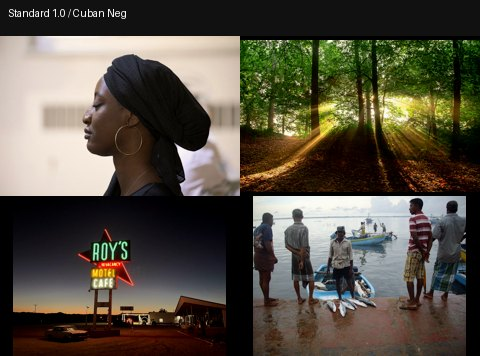

<details><summary>ค่าทั้งสูตรจากต้นฉบับ</summary>

```json
{
  "name": "Cuban Neg",
  "notes": "Inspired by Osan's Classic Cuban Neg: warm Classic Neg, golden cast (WB A+4), deep blues/reds, gritty grain, bloom 3. Sat: +2 warm, -2 greens.",
  "kind": "colour",
  "hue": [
    0,
    -1,
    0,
    0,
    7,
    6,
    -4,
    -3,
    6,
    7,
    5,
    0
  ],
  "light": [
    -1,
    -2,
    -3,
    -3,
    -1,
    0,
    -1,
    -2,
    -2,
    -3,
    -5,
    -4
  ],
  "sat": [
    2,
    2,
    2,
    2,
    0,
    -2,
    1,
    1,
    1,
    -2,
    -1,
    0
  ],
  "grain": "fine",
  "wb": {
    "a_b": 4,
    "g_m": 0
  },
  "effect": {
    "type": "bloom",
    "strength": 3
  },
  "vignette": 0,
  "art_effect": "off",
  "tone": {
    "highlights": 1,
    "shadows": -3,
    "midtones": 1,
    "blacks": 0,
    "whites": -2
  },
  "advice": {
    "tone": {
      "highlights": 1,
      "shadows": -3,
      "midtones": 1
    },
    "contrast": 1
  }
}
```

</details>

### Cibachrome

สีเข้มและอิ่มแบบภาพอัดจากสไลด์ — Cibachrome print (Jay, om-recipes): glossy magenta-reds, deep blues, rich darks.


<details><summary>ค่าทั้งสูตรจากต้นฉบับ</summary>

```json
{
  "name": "Cibachrome",
  "notes": "Cibachrome print (Jay, om-recipes): glossy magenta-reds, deep blues, rich darks.",
  "kind": "colour",
  "hue": [
    0,
    0,
    0,
    -1,
    0,
    0,
    0,
    0,
    0,
    0,
    0,
    0
  ],
  "light": [
    0,
    0,
    -1,
    -1,
    0,
    0,
    -1,
    -1,
    -1,
    0,
    0,
    0
  ],
  "sat": [
    1,
    3,
    4,
    3,
    4,
    2,
    2,
    4,
    3,
    0,
    2,
    -1
  ],
  "grain": "off",
  "wb": {
    "a_b": 1,
    "g_m": -1
  },
  "effect": null,
  "vignette": 0,
  "art_effect": "off",
  "tone": {
    "highlights": -3,
    "shadows": -2,
    "midtones": 1,
    "blacks": -1,
    "whites": 1
  },
  "advice": {
    "tone": {
      "highlights": -3,
      "shadows": -2,
      "midtones": 1
    },
    "contrast": 1
  }
}
```

</details>

### UltraMax 400

โทนอุ่น สีชัดสำหรับถ่ายทั่วไป — Kodak consumer negative: warm, punchy reds/yellows, olive greens, visible grain.


<details><summary>ค่าทั้งสูตรจากต้นฉบับ</summary>

```json
{
  "name": "UltraMax 400",
  "notes": "Kodak consumer negative: warm, punchy reds/yellows, olive greens, visible grain.",
  "kind": "colour",
  "hue": [
    0,
    0,
    0,
    0,
    0,
    0,
    -1,
    -1,
    0,
    0,
    -2,
    -2
  ],
  "light": [
    1,
    0,
    0,
    -1,
    0,
    0,
    -1,
    -1,
    0,
    0,
    -1,
    0
  ],
  "sat": [
    3,
    2,
    2,
    2,
    0,
    -1,
    0,
    0,
    -1,
    -1,
    1,
    2
  ],
  "grain": "film",
  "wb": {
    "a_b": 1,
    "g_m": 0
  },
  "effect": null,
  "vignette": 0,
  "art_effect": "off",
  "tone": {
    "highlights": 0,
    "shadows": -1,
    "midtones": 0,
    "blacks": 0,
    "whites": -1
  },
  "advice": {
    "tone": {
      "highlights": 0,
      "shadows": -1,
      "midtones": 0
    },
    "contrast": 1
  }
}
```

</details>

### Agfa Vista

สีสดแบบฟิล์มเนกาทีฟ — Agfa Vista 200: vivid magenta-leaning reds, deep blues, cool cheap-film punch.


<details><summary>ค่าทั้งสูตรจากต้นฉบับ</summary>

```json
{
  "name": "Agfa Vista",
  "notes": "Agfa Vista 200: vivid magenta-leaning reds, deep blues, cool cheap-film punch.",
  "kind": "colour",
  "hue": [
    0,
    0,
    -1,
    -1,
    0,
    0,
    0,
    0,
    0,
    0,
    1,
    0
  ],
  "light": [
    0,
    0,
    -1,
    -1,
    0,
    0,
    -1,
    -1,
    0,
    0,
    0,
    0
  ],
  "sat": [
    1,
    1,
    3,
    4,
    2,
    0,
    1,
    1,
    0,
    -1,
    0,
    0
  ],
  "grain": "fine",
  "wb": {
    "a_b": 0,
    "g_m": -1
  },
  "effect": null,
  "vignette": 0,
  "art_effect": "off",
  "tone": {
    "highlights": 0,
    "shadows": -1,
    "midtones": 0,
    "blacks": 0,
    "whites": -1
  },
  "advice": {
    "tone": {
      "highlights": 0,
      "shadows": -1,
      "midtones": 0
    },
    "contrast": 1
  }
}
```

</details>

### CineStill50D

โทนภาพยนตร์กลางวัน — Daylight cinema stock: clean, slightly cool, rich blues, soft highlights, faint red glow.


<details><summary>ค่าทั้งสูตรจากต้นฉบับ</summary>

```json
{
  "name": "CineStill50D",
  "notes": "Daylight cinema stock: clean, slightly cool, rich blues, soft highlights, faint red glow.",
  "kind": "colour",
  "hue": [
    0,
    0,
    0,
    0,
    0,
    0,
    0,
    -1,
    -1,
    1,
    1,
    0
  ],
  "light": [
    1,
    0,
    0,
    0,
    0,
    0,
    -1,
    -1,
    0,
    0,
    0,
    0
  ],
  "sat": [
    0,
    0,
    0,
    0,
    0,
    0,
    2,
    2,
    1,
    -1,
    -1,
    -1
  ],
  "grain": "fine",
  "wb": {
    "a_b": -1,
    "g_m": 0
  },
  "effect": {
    "type": "bloom",
    "strength": 2,
    "tint": "red"
  },
  "vignette": 0,
  "art_effect": "off",
  "tone": {
    "highlights": -2,
    "shadows": 2,
    "midtones": 0,
    "blacks": 0,
    "whites": -2
  },
  "advice": {
    "tone": {
      "highlights": -2,
      "shadows": 2,
      "midtones": 0
    },
    "contrast": -1
  }
}
```

</details>

### Vision3 250D

โทนภาพยนตร์แสงกลางวัน — Kodak daylight cinema negative: flat, wide latitude, gentle teal/orange separation.


<details><summary>ค่าทั้งสูตรจากต้นฉบับ</summary>

```json
{
  "name": "Vision3 250D",
  "notes": "Kodak daylight cinema negative: flat, wide latitude, gentle teal/orange separation.",
  "kind": "colour",
  "hue": [
    0,
    1,
    0,
    0,
    0,
    0,
    -1,
    -2,
    -1,
    1,
    1,
    0
  ],
  "light": [
    0,
    0,
    0,
    0,
    0,
    0,
    -1,
    -1,
    0,
    0,
    -1,
    -1
  ],
  "sat": [
    -1,
    0,
    0,
    -1,
    -2,
    -2,
    -1,
    -1,
    -1,
    -2,
    -2,
    -2
  ],
  "grain": "fine",
  "wb": null,
  "effect": null,
  "vignette": 0,
  "art_effect": "off",
  "tone": {
    "highlights": -3,
    "shadows": 3,
    "midtones": 0,
    "blacks": 1,
    "whites": -1
  },
  "advice": {
    "tone": {
      "highlights": -3,
      "shadows": 3,
      "midtones": 0
    },
    "contrast": -2
  }
}
```

</details>

### Vision3 500T

โทนภาพยนตร์แสงทังสเตน — Tungsten cinema negative in daylight: cool teal cast, warm lights, open shadows.


<details><summary>ค่าทั้งสูตรจากต้นฉบับ</summary>

```json
{
  "name": "Vision3 500T",
  "notes": "Tungsten cinema negative in daylight: cool teal cast, warm lights, open shadows.",
  "kind": "colour",
  "hue": [
    0,
    1,
    0,
    0,
    0,
    0,
    0,
    -2,
    -2,
    1,
    2,
    0
  ],
  "light": [
    0,
    1,
    1,
    0,
    0,
    0,
    -1,
    0,
    0,
    0,
    -1,
    -1
  ],
  "sat": [
    -1,
    0,
    1,
    1,
    -1,
    -1,
    1,
    1,
    1,
    -1,
    -2,
    -2
  ],
  "grain": "film",
  "wb": {
    "a_b": -2,
    "g_m": 0
  },
  "effect": {
    "type": "bloom",
    "strength": 1,
    "tint": "red"
  },
  "vignette": 0,
  "art_effect": "off",
  "tone": {
    "highlights": -2,
    "shadows": 3,
    "midtones": 0,
    "blacks": 1,
    "whites": -1
  },
  "advice": {
    "tone": {
      "highlights": -2,
      "shadows": 3,
      "midtones": 0
    },
    "contrast": -1
  }
}
```

</details>

### Polaroid

สีจางและดำยกแบบภาพทันใจ — Integral instant film: punchy, narrow dynamic range (bright highlights, deep shadows), warm highlights, cyan-green shadows.

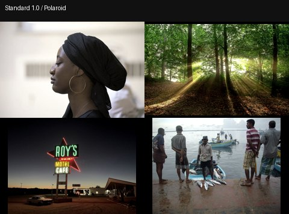

<details><summary>ค่าทั้งสูตรจากต้นฉบับ</summary>

```json
{
  "name": "Polaroid",
  "notes": "Integral instant film: punchy, narrow dynamic range (bright highlights, deep shadows), warm highlights, cyan-green shadows.",
  "kind": "colour",
  "hue": [
    1,
    1,
    0,
    0,
    0,
    0,
    -1,
    -1,
    0,
    1,
    2,
    1
  ],
  "light": [
    1,
    1,
    1,
    0,
    0,
    0,
    1,
    1,
    1,
    1,
    0,
    0
  ],
  "sat": [
    -1,
    -1,
    -2,
    -2,
    -2,
    -2,
    -3,
    -3,
    -2,
    -1,
    -2,
    -1
  ],
  "grain": "fine",
  "wb": {
    "a_b": 1,
    "g_m": 1
  },
  "effect": {
    "type": "bloom",
    "strength": 2,
    "tint": "warm"
  },
  "vignette": 0,
  "art_effect": "off",
  "tone": {
    "highlights": 2,
    "shadows": -3,
    "midtones": 0,
    "blacks": -1,
    "whites": 1
  },
  "advice": {
    "tone": {
      "highlights": -3,
      "shadows": 4,
      "midtones": 1
    },
    "contrast": -2
  }
}
```

</details>

### Cross Proc.

สีเพี้ยนและคอนทราสต์เฉพาะตัว — E-6 slide in C-41: hard contrast, yellow-green highlights, cyan skies, yellowed skin.


<details><summary>ค่าทั้งสูตรจากต้นฉบับ</summary>

```json
{
  "name": "Cross Proc.",
  "notes": "E-6 slide in C-41: hard contrast, yellow-green highlights, cyan skies, yellowed skin.",
  "kind": "colour",
  "hue": [
    -2,
    0,
    0,
    -1,
    -2,
    -1,
    -2,
    -3,
    -2,
    -3,
    -3,
    -3
  ],
  "light": [
    2,
    1,
    0,
    -1,
    -1,
    0,
    -1,
    -1,
    0,
    0,
    0,
    1
  ],
  "sat": [
    3,
    2,
    2,
    3,
    1,
    0,
    2,
    3,
    3,
    2,
    3,
    4
  ],
  "grain": "film",
  "wb": {
    "a_b": 1,
    "g_m": 2
  },
  "effect": null,
  "vignette": 0,
  "art_effect": "off",
  "tone": {
    "highlights": 2,
    "shadows": -3,
    "midtones": 0,
    "blacks": -1,
    "whites": 1
  },
  "advice": {
    "tone": {
      "highlights": 2,
      "shadows": -3,
      "midtones": 0
    },
    "contrast": 2
  }
}
```

</details>

### Atrophy

สีเก่าและซีดจาง — Inspired by GxAce's Atrophy: urban-decay grade, near-grey base, muted greens/skies, rust and reds kept, gritty clarity. Sat advice: greens/blues -4..-5.

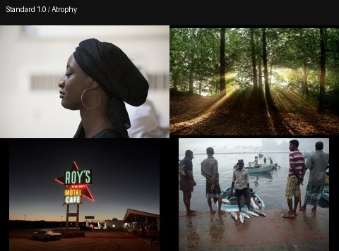

<details><summary>ค่าทั้งสูตรจากต้นฉบับ</summary>

```json
{
  "name": "Atrophy",
  "notes": "Inspired by GxAce's Atrophy: urban-decay grade, near-grey base, muted greens/skies, rust and reds kept, gritty clarity. Sat advice: greens/blues -4..-5.",
  "kind": "colour",
  "hue": [
    -2,
    -1,
    0,
    0,
    2,
    1,
    -2,
    -1,
    0,
    2,
    2,
    -1
  ],
  "light": [
    -1,
    0,
    -1,
    -1,
    -1,
    -1,
    -2,
    -2,
    -1,
    -2,
    -3,
    -2
  ],
  "sat": [
    -2,
    -1,
    1,
    1,
    -3,
    -4,
    -4,
    -4,
    -4,
    -5,
    -5,
    -5
  ],
  "grain": "fine",
  "wb": {
    "a_b": -1,
    "g_m": 1
  },
  "effect": {
    "type": "clarity",
    "strength": 3
  },
  "vignette": 0,
  "art_effect": "off",
  "tone": {
    "highlights": -1,
    "shadows": -2,
    "midtones": 0,
    "blacks": 1,
    "whites": -1
  },
  "advice": {
    "tone": {
      "highlights": -1,
      "shadows": -2,
      "midtones": 0
    },
    "contrast": 1
  }
}
```

</details>

### Acros

ขาวดำไล่น้ำหนักนุ่ม — Fine-grain mono: deep blacks, smooth tones, darker reds.


<details><summary>ค่าทั้งสูตรจากต้นฉบับ</summary>

```json
{
  "name": "Acros",
  "notes": "Fine-grain mono: deep blacks, smooth tones, darker reds.",
  "kind": "mono",
  "hue": [
    0,
    0,
    0,
    0,
    0,
    0,
    0,
    0,
    0,
    0,
    0,
    0
  ],
  "light": [
    0,
    0,
    0,
    0,
    0,
    0,
    0,
    0,
    0,
    0,
    0,
    0
  ],
  "sat": [
    0,
    0,
    0,
    0,
    0,
    0,
    0,
    0,
    0,
    0,
    0,
    0
  ],
  "grain": "fine",
  "wb": null,
  "effect": null,
  "vignette": 0,
  "art_effect": "off",
  "tone": {
    "highlights": 0,
    "shadows": 0,
    "midtones": 0,
    "blacks": 0,
    "whites": 0
  },
  "advice": {
    "tone": {
      "highlights": -1,
      "shadows": -2,
      "midtones": 0
    },
    "contrast": 1,
    "mono_filter": {
      "colour": "green",
      "strength": 1
    }
  }
}
```

</details>

### Tri-X 400

ขาวดำคอนทราสต์ชัด — Classic gritty reportage mono: punchy contrast, darker skies.

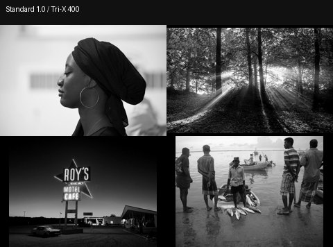

<details><summary>ค่าทั้งสูตรจากต้นฉบับ</summary>

```json
{
  "name": "Tri-X 400",
  "notes": "Classic gritty reportage mono: punchy contrast, darker skies.",
  "kind": "mono",
  "hue": [
    0,
    0,
    0,
    0,
    0,
    0,
    0,
    0,
    0,
    0,
    0,
    0
  ],
  "light": [
    0,
    0,
    0,
    0,
    0,
    0,
    0,
    0,
    0,
    0,
    0,
    0
  ],
  "sat": [
    0,
    0,
    0,
    0,
    0,
    0,
    0,
    0,
    0,
    0,
    0,
    0
  ],
  "grain": "film",
  "wb": null,
  "effect": null,
  "vignette": 0,
  "art_effect": "off",
  "tone": {
    "highlights": 0,
    "shadows": 0,
    "midtones": 0,
    "blacks": 0,
    "whites": 0
  },
  "advice": {
    "tone": {
      "highlights": -1,
      "shadows": -3,
      "midtones": 0
    },
    "contrast": 2,
    "mono_filter": {
      "colour": "yellow",
      "strength": 2
    }
  }
}
```

</details>

### HP5 Plus

ขาวดำใช้งานทั่วไป มีน้ำหนักกลาง — Soft, grainy mono with wide latitude and open shadows.


<details><summary>ค่าทั้งสูตรจากต้นฉบับ</summary>

```json
{
  "name": "HP5 Plus",
  "notes": "Soft, grainy mono with wide latitude and open shadows.",
  "kind": "mono",
  "hue": [
    0,
    0,
    0,
    0,
    0,
    0,
    0,
    0,
    0,
    0,
    0,
    0
  ],
  "light": [
    0,
    0,
    0,
    0,
    0,
    0,
    0,
    0,
    0,
    0,
    0,
    0
  ],
  "sat": [
    0,
    0,
    0,
    0,
    0,
    0,
    0,
    0,
    0,
    0,
    0,
    0
  ],
  "grain": "film",
  "wb": null,
  "effect": null,
  "vignette": 0,
  "art_effect": "off",
  "tone": {
    "highlights": 0,
    "shadows": 0,
    "midtones": 0,
    "blacks": 0,
    "whites": 0
  },
  "advice": {
    "tone": {
      "highlights": -2,
      "shadows": 1,
      "midtones": 0
    },
    "mono_filter": {
      "colour": "none",
      "strength": 1
    }
  }
}
```

</details>
